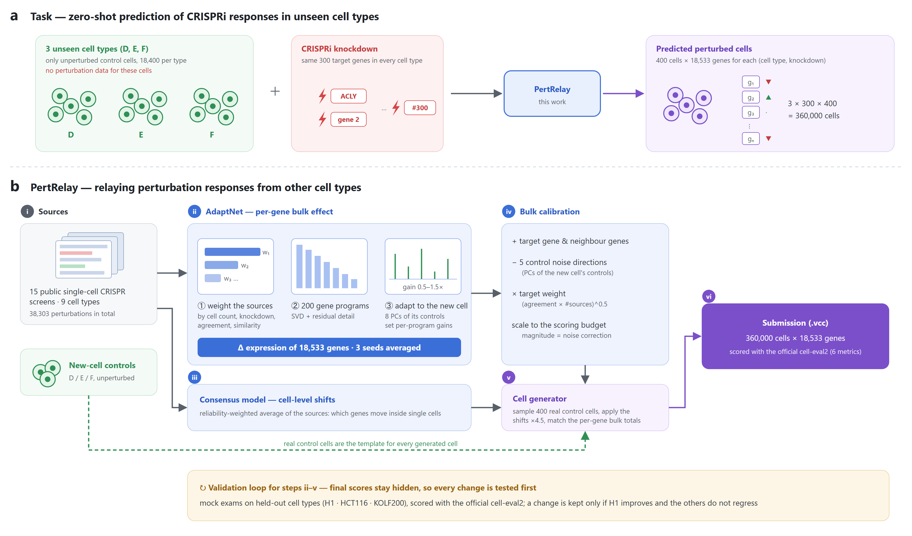

# PertRelay

在一種只有對照組資料的細胞裡，抑制某個基因後，哪些基因的表現會跟著改變？PertRelay 利用其他細胞種類的公開擾動實驗，結合目標細胞本身的基因表現，預測它對同一擾動的反應。

**競賽**　[Arc Virtual Cell Challenge 2026](https://virtualcellchallenge.org)

**團隊**　NTU JHLab · 國立臺灣大學

**模型名稱**　PertRelay 取自 *Perturbation Relay*，意指把已量測的擾動反應「接力」到新的細胞種類。PertRelay 是整套預測流程的名稱，其中的 AdaptNet 負責估計擾動後各基因的整體表現變化。[模型與架構說明](general_model/README.md)

## 團隊成員

| 姓名 | 所屬系所 |
| --- | --- |
| 王獻霆 | 國立臺灣大學生醫電子與資訊學研究所 |
| 林旭慶 | 國立臺灣大學資訊工程學系 |
| 周宗穎 | 國立臺灣大學資訊工程學系 |
| 黃衍顥 | 國立臺灣大學資訊工程學系 |

**指導教授**　黃宣誠，國立臺灣大學資訊工程學系教授。研究專長涵蓋生物資訊學、計算生物學、系統生物學與生醫資料科學。[臺大師資介紹](https://www.csie.ntu.edu.tw/zh_tw/member/Faculty/%E9%BB%83%E5%AE%A3%E8%AA%A0-Hsuan-Cheng-Huang-2010123)

**專案 GitHub 帳號**　[zxc29051617](https://github.com/zxc29051617) · [scnpg](https://github.com/scnpg)

## 挑戰與方法

期末測試提供三種細胞（D、E、F）的未處理對照組。對每種細胞，團隊都要預測分別以 CRISPRi 抑制同一組 300 個目標基因後的反應。每個「細胞種類 × 擾動」組合須產生 400 顆細胞，每顆提供 18,533 個基因的表現讀數。這是零樣本預測，因為模型在這三種細胞上只看得到對照組。

| 步驟 | PertRelay 的做法 |
| --- | --- |
| 整理已知反應 | 彙整 15 個公開實驗，涵蓋 9 類細胞、38,303 組「細胞種類 × 目標基因」的量測。 |
| 遷移到新細胞 | AdaptNet 為各來源實驗分配權重，再依目標細胞對照組的表現，調整各組基因的預測反應。 |
| 產生單細胞預測 | 從目標細胞的對照組抽取 400 顆實測細胞，依預測的整體變化調整讀數，保留細胞之間原有的表現差異。 |
| 比較候選版本 | 留出已有實測答案的細胞作為模擬考，用官方評分程式比較各版預測。 |



## 結果與進度

**驗證期公開榜（A、B、C）**　團隊以共識模型取得 **0.239 分，在 1,635 隊中排名第 165**。這是 AdaptNet 完成前的驗證期成績。期末提交使用下表的 **PertRelay 集成模型**，預測的細胞種類為 D、E、F。

**本地模擬考（H1）**　以下成績用於比較開發版本。0 分對應官方基準預測，1 分對應同一實驗兩次量測之間的一致程度。

| 模型名稱 | 預測方式 | 模擬考總分 |
| --- | --- | ---: |
| 跨來源共識模型 | 依來源可信度加權平均各實驗量到的擾動反應 | 0.272 |
| AdaptNet 遷移模型 | 學習各來源實驗的權重，再依新細胞的對照組表現調整預測 | 0.291 |
| **PertRelay 集成模型（期末提交）** | 納入 RPE1 資料，平均三個不同隨機種子訓練的 AdaptNet 預測，再移除五個對照組變異方向 | **0.306** |

團隊也用這組模擬考挑選設定，因此 0.306 是受選模影響的開發成績。期末測試使用不同的細胞。完整版本比較、六項分數與方法限制見模型文件第 9、10 節。[模型結果與實驗紀錄](general_model/README.md)

比賽初期，團隊也實作了將公開細胞擾動反應直接轉移到目標細胞的基準流程，當時記錄的最佳分數為 0.109。[初期實驗紀錄](docs/state_of_play.md) · [挑戰說明](docs/challenge_brief.md)

## 專案結構

```text
general_model/pertrelay/    PertRelay 模型、細胞產生流程與本地評分紀錄
general_model/vccsub/       產生並打包提交檔
general_model/tools/        下載與整理模型資料
general_model/docs/         模型圖表與實驗紀錄
general_model/papers/       模型參考文獻
src/、scripts/、experiments/  比賽初期的基準程式與實驗
docs/、data/、tests/          初期流程的文件、小型資料檔與測試
```

## 開始使用

若只想核對模擬考分數，可從 repo 根目錄執行下列指令。需要 `uv`，分數取自 repo 內已保存的評分紀錄，無須下載單細胞資料。

```sh
cd general_model/pertrelay
uv run --no-project --with numpy python model/mock_cmp.py 0,1,2,3,4 current v4_ax5
```

指令會彙整五組模擬考，跨來源共識模型（`current`）平均為 **0.2723**，PertRelay 集成模型（`v4_ax5`）為 **0.3063**。實驗紀錄中的 `v1`、`v2`、`v5` 依序對應上表三列。如要從頭建立環境、下載資料、訓練模型或重建期末提交檔，請見完整指南第 11 節。[安裝與重現指南](general_model/README.md)
