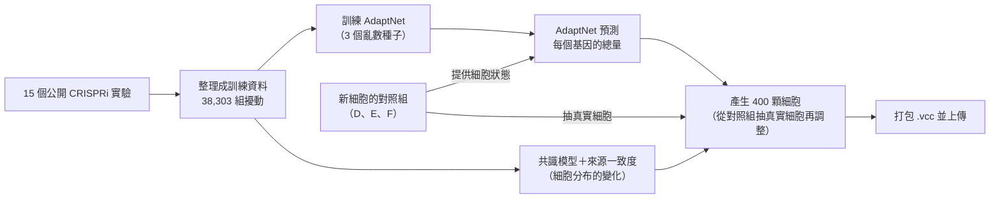
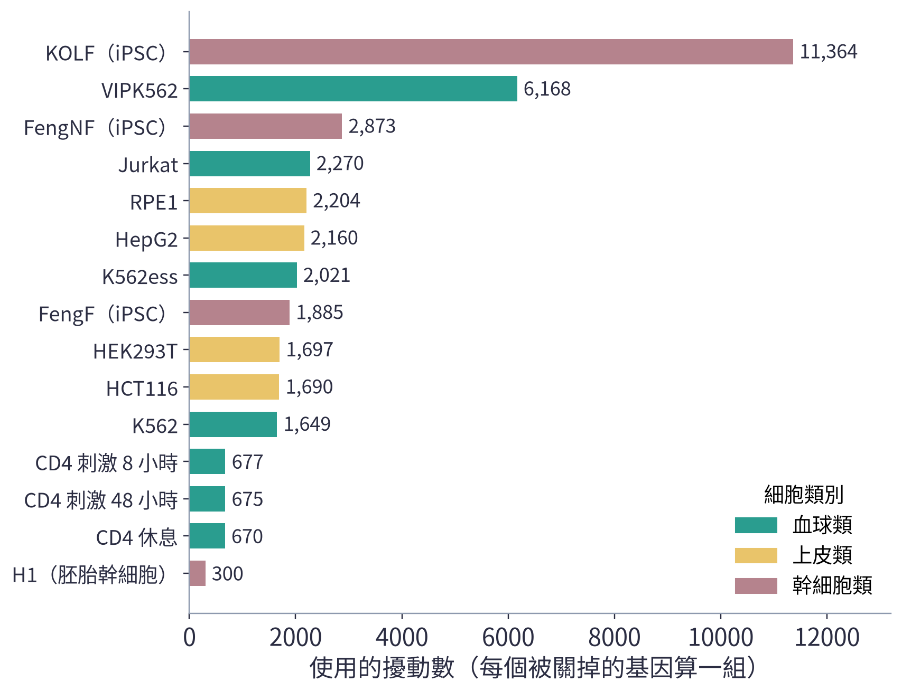
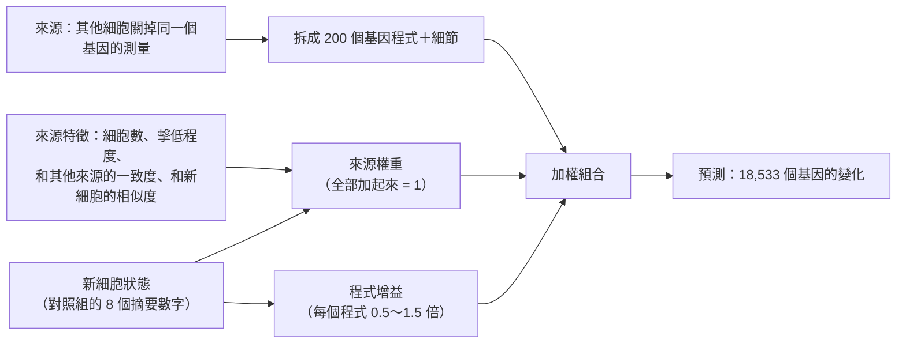
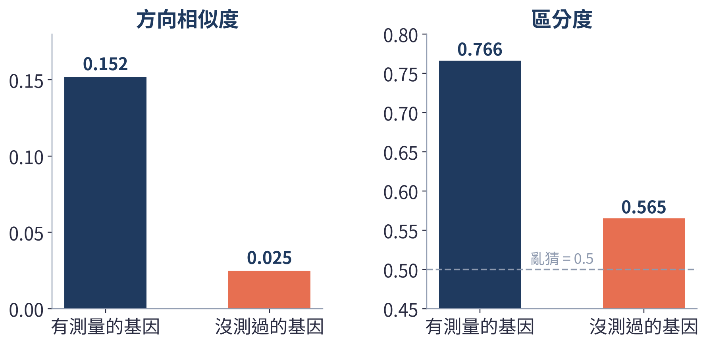
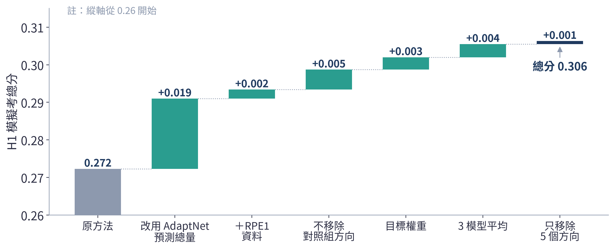
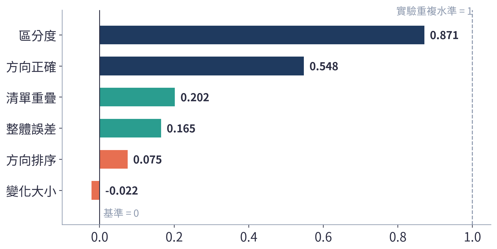
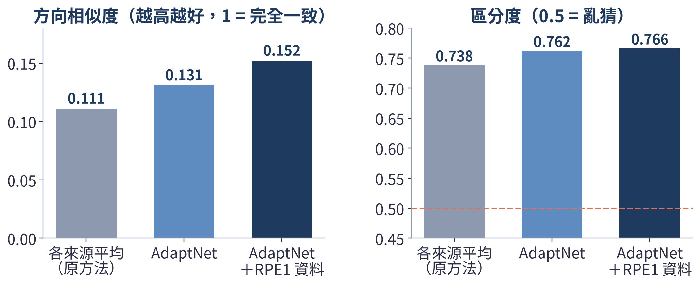
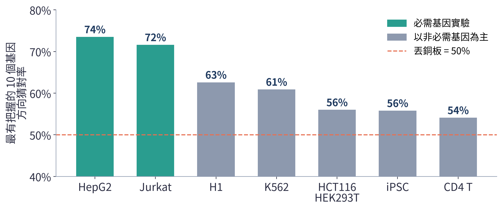

# VCC 2026：預測「關掉一個基因後，細胞會怎麼變」的通用模型

> 這份文件寫給**第一次接觸這個專案的人**，不需要生物或機器學習背景。
> 看到不懂的名詞，可以直接跳到 [13. 名詞解釋](#13-名詞解釋) 查。
> 期末算分的版本是 **v5**（台灣時間 2026/10/24 00:24 上傳）。

## 這份文件怎麼讀

| 你想要 | 讀這幾節 | 大約時間 |
| --- | --- | --- |
| 知道這個專案在做什麼 | 1、2、3 | 15 分鐘 |
| 看懂我們的方法和結果 | 4～10（第 4 節有一個完整的例子） | 40 分鐘 |
| 自己重跑程式 | 11、12 | 依步驟而定 |
| 查名詞、看常見問題 | 13、14 | 需要時再看 |

---

## 目錄

1. [一分鐘看懂](#1-一分鐘看懂)
2. [背景知識：需要知道的生物學](#2-背景知識需要知道的生物學)
3. [比賽規則與評分方式](#3-比賽規則與評分方式)
4. [解法總覽與一個完整的例子](#4-解法總覽與一個完整的例子)
5. [訓練資料](#5-訓練資料)
6. [模型：AdaptNet 一步一步看](#6-模型adaptnet-一步一步看)
7. [從預測到 400 顆細胞](#7-從預測到-400-顆細胞)
8. [怎麼驗證（為什麼相信這些數字）](#8-怎麼驗證為什麼相信這些數字)
9. [成績與版本歷史](#9-成績與版本歷史)
10. [主要發現、試過但沒用的方法、限制](#10-主要發現試過但沒用的方法限制)
11. [怎麼執行（從零開始）](#11-怎麼執行從零開始)
12. [資料夾與重要檔案導覽](#12-資料夾與重要檔案導覽)
13. [名詞解釋](#13-名詞解釋)
14. [常見問題](#14-常見問題)
15. [時間軸](#15-時間軸)
16. [論文與資料來源](#16-論文與資料來源)

---

## 1. 一分鐘看懂

**比賽在問什麼？**
主辦單位（美國 Arc Institute）給我們新的細胞種類（期末考有三種），但只給「沒被處理過」的樣子（稱為**對照組細胞**），
再告訴我們要「關掉」哪 300 個基因。我們要預測：每關掉一個基因，這種細胞裡 18,533 個基因的表現會怎麼改變，
而且要用「400 顆細胞的讀數」的形式交出去。

**為什麼這件事有用？**
這種實驗很貴，而且每換一種細胞就要重做。如果電腦能先準確預測，研究人員就能挑出最值得做的實驗。

**難在哪裡？**
期末考的三種細胞（代號 D、E、F），我們**完全沒有**它們被關掉任何基因的資料（稱為「零樣本」）。
只能參考**其他種類細胞**的實驗結果來推測，而不同細胞對同一個基因的反應常常不一樣。

**我們怎麼做？**
1. 收集 15 個公開的基因關閉實驗（9 類細胞、38,303 組「某種細胞中關掉某個基因」的測量）。
2. 訓練一個小型神經網路 **AdaptNet**：要預測「新細胞中關掉基因 X」時，它會判斷其他細胞裡關掉 X 的結果
   哪些比較可信，並依新細胞的狀態調整。
3. 從新細胞自己的對照組抽出 400 顆真實細胞，依照預測調整讀數，產生要交出去的細胞。
4. 每個改動都先用「模擬考」（答案已知的細胞＋官方評分程式）驗證，有進步才採用。

**成績**：模擬考從原方法的 0.272 進步到 0.306。這個分數的意思是：0 ＝ 和最簡單的猜法一樣，
1 ＝ 和「同一個實驗重做一次」一樣準（詳見第 3 節）。

---

## 2. 背景知識：需要知道的生物學

### 基因與基因表現
- 每顆細胞裡有約兩萬個基因。細胞會依需要把基因「抄寫」成 RNA，再用 RNA 做出蛋白質。
- **基因表現**＝某個基因被抄寫成多少 RNA。表現越高，代表這個基因越活躍。
- 同一個人身上的肝細胞、血球、皮膚細胞，基因都一樣，但**哪些基因在表現、表現多少**不一樣，所以長相和功能都不同。

### 單細胞 RNA 定序
- 一種實驗技術，可以一次量上萬顆細胞，數出**每顆細胞裡每個基因有幾個 RNA 分子**。
- 每數到一個 RNA 分子就記 1，這個數字叫**讀數**（英文 counts 或 UMI；UMI 是貼在每個分子上的條碼，確保同一個分子只算一次）。
  例如某顆細胞的 GAPDH 基因讀數是 35，代表在這顆細胞裡數到 35 個 GAPDH 的 RNA 分子。
- 結果是一張大表：每一列是一顆細胞、每一欄是一個基因、格子裡是讀數。比賽的資料每顆細胞有 18,533 個基因。
- **讀數深度**＝一顆細胞總共數到多少個分子。期末考的細胞平均每顆約 2 萬。深度越高，資料越可靠。
- 因為每顆細胞的深度不同，比較前會先換算成「每 5 萬個讀數中佔幾個」（程式裡叫 CP50k），這樣不同細胞才能公平比較。

### CRISPRi：把一個基因「關小聲」
- CRISPRi 是一種基因工具：用一個不會剪斷 DNA 的 Cas9 蛋白，帶著「抑制器」貼到目標基因上，讓它幾乎不再被抄寫。
- 比賽保證每個目標基因的表現都被壓低 80% 以上。這叫 **knockdown（擊低）**，不是把基因刪除。

### Perturb-seq：一次做幾千個「關基因」實驗
- 把一大群細胞分別關掉不同的基因（每顆細胞帶一段叫 **guide** 的序列，決定關哪個基因），再做單細胞定序。
- 這樣就能知道：關掉基因 A 時，其他所有基因怎麼變；關掉基因 B 時又怎麼變……
- 拿到「不針對任何基因」的 guide 的細胞叫**對照組**（non-targeting），代表沒被干擾的正常狀態。
- 對細胞做的這種處理統稱**擾動**（perturbation）；被關掉的基因叫**目標基因**（target）。

### 擾動反應怎麼表示
- 把「關掉 X 的那組細胞」的讀數加總，當成一顆「平均細胞」，叫 **pseudobulk（偽總體）**；對照組也一樣處理。
- 兩者相除得到**倍數變化**，再取對數，叫 **log fold change（對數倍數變化）**：
  - 例：對照組平均每顆細胞有 10 個 A 基因的讀數，關掉 X 後剩 5 個 → 倍數 0.5（下降一半）→ log₂ 倍數變化 = −1。
  - 如果變成 20 個 → 倍數 2（變兩倍）→ log₂ 倍數變化 = +1。
  - 大於 0 代表**上升**，小於 0 代表**下降**，接近 0 代表沒變。

### 必需基因 vs 非必需基因
- **必需基因**：細胞活下去一定要的基因。關掉後細胞會出大問題，反應通常很大，而且在不同細胞裡很一致。
- **非必需基因**：關掉後影響較小，而且反應常常因細胞種類而不同，所以很難預測。
- 期末考的 300 個基因**大多是非必需基因**，這是本專案最大的難點（見第 10 節）。

### 為什麼不同細胞的反應會不一樣？
同一個基因在不同細胞裡的角色不同：例如某個基因在血球裡負責重要工作，在皮膚細胞裡卻幾乎沒在用。
所以「在 K562 細胞關掉 X 的結果」不能直接搬到 D 細胞，需要判斷哪些部分能沿用、哪些要調整——這就是 AdaptNet 在做的事。

> 用詞提醒：本文說「細胞種類」或「細胞」（例如 K562、D）指一整種細胞；說「一顆細胞」才是指單一細胞。

### 機器學習與統計的基本概念（後面會用到）

- **神經網路、參數、訓練**：神經網路是一種「可以從資料自動學規則」的數學函數，裡面有很多可以調的數字（參數）。
  訓練就是一直拿題目給它做、對答案，再微調參數讓答案越來越準。衡量「答案有多差」的分數叫**損失函數**，訓練的目標是讓它變小。
- **過度擬合**：模型把訓練資料「背起來」，換到新資料就不準。資料越少、模型越大，越容易發生。
- **交叉驗證**：把資料分成幾份，輪流藏起一份當考題、用其他份訓練，可以公平地估計模型對新資料準不準。
- **亂數種子**：訓練時有很多隨機選擇，亂數種子決定這些選擇；換種子會得到略有不同的模型，把幾個模型取平均會更穩定。
- **主成分分析（PCA）、SVD**：從很多個數字裡找出「最主要的幾種變化型態」的數學方法，可以把上萬個基因濃縮成幾個代表性的數字。
- **統計檢定、p 值、顯著**：判斷兩組數字的差異是真的、還是碰巧的方法。p 值越小，越可能是真的有差異；夠小就稱為「顯著」。
- **相關係數、餘弦相似度**：衡量兩串數字有多像。1 ＝ 完全同步、0 ＝ 毫無關係、−1 ＝ 完全相反。

---

## 3. 比賽規則與評分方式

### 規則重點

| 項目 | 內容 |
| --- | --- |
| 主辦 | Arc Institute，Virtual Cell Challenge 2026 |
| 驗證期 | 細胞 A、B、C，有公開排行榜（到 2026/10/22） |
| 期末考 | 細胞 D、E、F，每種給 18,400 顆對照組細胞，三種細胞都要預測同一組 300 個目標基因 |
| 要交什麼 | 每個目標基因 400 顆細胞 × 18,533 個基因的讀數，共 3 × 300 × 400 ＝ 36 萬顆細胞，打包成 `.vcc` 檔 |
| 截止 | 2026/11/05 23:59（UTC，等於台灣時間 11/06 早上 7:59）；每天最多上傳 2 次，**只算最後一次** |
| 分數公布 | 比賽結束、公布得獎者時才公開（期末期間看不到分數） |

### 分數怎麼換算（看懂所有數字的關鍵）

評分程式先算出六項「原始分數」，再把每一項換算到同一個尺度：

**換算分數 ＝（我們的原始分數 − 基準的原始分數）÷（實驗重複的原始分數 − 基準的原始分數）**

- **基準**（baseline）：每個目標基因都猜成「這種細胞所有擾動的平均反應」。注意這個平均是評分程式用**真實答案**算的，
  我們事先拿不到，所以 0 分並不是隨便就能拿到的。
- **實驗重複**（replicate）：把真實答案的細胞隨機分成兩半，用一半去「猜」另一半。真實實驗本身也有雜訊，這代表實際上能達到的水準。
- 例：某一項的原始分數，基準是 0.50、實驗重複是 0.90、我們是 0.70 → 換算分數 ＝（0.70 − 0.50）÷（0.90 − 0.50）＝ **0.5**。

所以：**0 分 ＝ 和基準一樣；1 分 ＝ 和實驗重做一次一樣好；負數 ＝ 比基準還差**。總分是六項換算分數的平均，越高越好。
本文說「原始分數」就是換算前的值，說「換算分數」或「分數」就是換算後的值。

### 六項分數

下表最右欄的兩個詞，整份文件都會用到：

- **總量**：某個基因在 400 顆細胞裡的讀數加起來（等於看這個基因的平均值）。
- **細胞分布**：每一顆細胞各自的讀數長什麼樣子（有幾顆細胞是 0、有幾顆特別高……）。

| 項目（程式裡的名字） | 白話意思 | 主要由什麼決定 |
| --- | --- | --- |
| 區分度（`pds_cosine`） | 對每個目標基因，拿我們的預測去和「所有目標基因的真實反應」比相似度；和自己那一個最像，代表不同擾動被分得開 | 每個基因的總量 |
| 整體誤差（`expr_mse`） | 每個基因的平均表現量，預測和真實差多少（原始分數越小越好，換算後越大越好） | 每個基因的總量 |
| 變化大小（`lfc_nmae`） | 真實資料中「顯著改變」的基因，我們預測的變化倍數差多少 | 總量與細胞分布 |
| 方向正確（`direction_fidelity`） | 我們判定為顯著、而且升降方向也對的基因有幾個，再除以「我們宣告的數量」和「真實顯著的數量」中較大的那個——所以多報、少報都會被扣分 | 細胞分布 |
| 方向排序（`direction_reach`） | 把真實顯著的基因依我們的把握程度排序，從最有把握的往下看，在方向正確率維持 90% 以上的範圍內，能涵蓋多少個 | 細胞分布 |
| 清單重疊（`sig_jaccard`） | 我們的「顯著基因清單」和真實清單的交集 ÷ 聯集 | 細胞分布 |

評分程式輸出的完整欄位名稱和本文、程式裡的簡稱對照：
`pds_cosine` ＝ pds ＝ 區分度；`expr_mse_unbiased_capped_norm` ＝ mse ＝ 整體誤差；`de_wilcoxon_lfc_nmae` ＝ nmae ＝ 變化大小；
`de_wilcoxon_direction_fidelity_yield_raw` ＝ fid ＝ 方向正確；`de_wilcoxon_direction_reach_raw` ＝ reach ＝ 方向排序；
`de_wilcoxon_sig_jaccard` ＝ jac ＝ 清單重疊。名稱裡的 DE（differential expression）就是「顯著改變」。

**「顯著改變」怎麼判定？** 評分程式會拿我們交的 400 顆細胞和對照組細胞，對每個基因做 **Wilcoxon 檢定**（一種比較兩組數字分布是否不同的統計方法），
得到一個 **p 值**：「如果其實沒有差別，會看到這麼大差異的機率」。p 值很小，就判定這個基因「顯著改變」。
所以除了平均值，**每顆細胞的讀數怎麼分布**也會影響分數。這就是第 7 節要把「總量」和「細胞」分開處理的原因。

---

## 4. 解法總覽與一個完整的例子



（D、E、F 的對照組不是拿來訓練的：它只告訴模型「新細胞長什麼樣子」，並提供產生細胞時的真實細胞。）

整個流程分兩大部分：

1. **預測（模型）**：對每個「新細胞 × 被關掉的基因」，預測 18,533 個基因的變化量。
2. **產生細胞**：把預測變成 400 顆細胞的讀數，同時顧好評分程式看的「總量」和「細胞分布」。

這裡有兩個模型，分工不同：

| 模型 | 是什麼 | 負責 |
| --- | --- | --- |
| **共識模型**（原方法，也就是 v1） | 把各來源（其他細胞的實驗結果）依可信度直接平均的簡單方法，程式在 `scDFM/vcc/gm.py` | **細胞分布**的變化（影響顯著基因的四項分數） |
| **AdaptNet**（本專案訓練的模型） | 學會怎麼依新細胞的狀態組合來源的小型神經網路（第 6 節） | 每個基因的**總量**（影響區分度和整體誤差） |

我們也試過讓 AdaptNet 同時負責細胞分布，但它的預測比較平滑，會讓太多基因被判成顯著，「方向正確」反而變差，所以細胞分布仍用共識模型。

### 一個完整的例子：在 D 細胞裡關掉 ACLY

下面的數字都是期末 v5 實際交出去的預測。

1. **題目**：ACLY 是製造「乙醯輔酶 A」的酵素，乙醯輔酶 A 是細胞做脂肪和膽固醇的原料。
   我們要預測：D 細胞關掉 ACLY 之後，18,533 個基因各會怎麼變。
2. **找來源**：15 個訓練實驗中，有 10 個實驗關掉過 ACLY（CD4 T 細胞的三種狀態、FengNF、H1、HCT116、HEK293T、K562、KOLF、VIPK562）。
   這 10 份結果就是「來源」。
3. **AdaptNet 組合來源**：依每個來源的可信度和 D 細胞的狀態給權重、做調整，輸出 18,533 個數字，也就是每個基因的預測變化。
4. **看結果**：
   - ACLY 本身預測下降約 85%（比賽保證目標基因會下降 80% 以上）。
   - 在 D 細胞裡有表現的基因中（對照組每 5 萬個讀數至少 2 個，約 6,000 個），預測上升最多的 10 個是
     SPNS3、ACSS2、HMGCS1、MVD、ACAT2、PLAC8、ATF5、MSMO1、INSIG1、HMGCR。
   - 其中 7 個和乙醯輔酶 A 或膽固醇的製造有關：

     | 基因 | 功能 | 預測變化 |
     | --- | --- | --- |
     | ACSS2 | 從醋酸製造乙醯輔酶 A（ACLY 以外的另一條路） | 約 3.0 倍 |
     | HMGCS1 | 膽固醇合成的早期步驟 | 約 2.8 倍 |
     | MVD | 膽固醇合成路徑 | 約 2.3 倍 |
     | ACAT2 | 乙醯輔酶 A 的利用、膽固醇合成 | 約 2.3 倍 |
     | MSMO1 | 膽固醇合成路徑 | 約 1.9 倍 |
     | INSIG1 | 調控膽固醇合成的回饋開關 | 約 1.9 倍 |
     | HMGCR | 膽固醇合成的關鍵酵素（降膽固醇藥物 statin 的作用對象） | 約 1.9 倍 |

     這和已知的生物學一致：少了 ACLY，細胞會改用 ACSS2 製造乙醯輔酶 A，並拉高膽固醇合成相關基因。
     代表模型從其他細胞的實驗中，學到了有意義的規律。
   - 同一個 ACLY 在 D、E、F 三種細胞的預測非常接近（相關係數 0.99）。因為三種細胞都和訓練資料差很多，
     模型給各來源的權重差不多。這也是目前的限制之一（第 10 節）。
5. **產生細胞**：從 D 的 18,400 顆對照組細胞中抽 400 顆，把 ACLY 的讀數調低、ACSS2 等基因的讀數調高，就是要交出去的答案。

---

## 5. 訓練資料

### 15 個公開實驗

| 細胞 | 細胞是什麼 | 資料來源 | 擾動數 | 授權 |
| --- | --- | --- | --- | --- |
| K562 | 慢性骨髓性白血病細胞 | Replogle et al. 2022，全基因組 | 1,649 | CC BY 4.0 |
| K562ess | 同上 | Replogle et al. 2022，必需基因 | 2,021 | CC BY 4.0 |
| VIPK562 | 同上 | VIPerturb-seq（Satija lab，2026，10x Flex） | 6,168 | CC BY 4.0 |
| HCT116 | 大腸癌細胞 | X-Atlas/Orion（Xaira） | 1,690 | CC BY-NC-SA 4.0 |
| HEK293T | 胚胎腎細胞 | X-Atlas/Orion（Xaira） | 1,697 | CC BY-NC-SA 4.0 |
| H1 | 胚胎幹細胞 | Virtual Cell Challenge 2025 | 300 | CC0 |
| CD4_Rest / Stim8hr / Stim48hr | 人類 CD4 T 細胞（休息、刺激 8 小時、48 小時） | Marson lab 全基因組 CRISPRi | 670 / 677 / 675 | MIT |
| HepG2 | 肝癌細胞 | Nadig et al. 2025，必需基因 | 2,160 | 未註明 |
| Jurkat | T 細胞白血病 | Nadig et al. 2025，必需基因 | 2,270 | 未註明 |
| FengNF / FengF | 誘導多能幹細胞（34 位捐贈者） | Feng et al. 2025（非必需／必需基因組） | 2,873 / 1,885 | MIT |
| KOLF | 誘導多能幹細胞 | KOLF2.1J 全基因組 CRISPRi（Nature Biotechnology 2026） | 11,364 | CC BY 4.0 |
| RPE1 | 視網膜色素上皮細胞 | Replogle et al. 2022，必需基因 | 2,204 | CC BY 4.0 |
| **合計** | **9 類細胞** | | **38,303** | |

- **擾動數**：我們從這個實驗**抽出來實際使用**的擾動數（每個被關掉的基因算一組）。大型實驗（例如 K562 全基因組關掉了約 9,900 個基因）
  只抽了和比賽有關的基因、1,000 個輔助基因和期末考的 300 個，所以表上的數字比原始實驗小。
- 用斜線寫在同一列的（CD4 的三種狀態、Feng 的兩組）各算一個實驗，所以 12 列合計是 15 個實驗。
- **10x Flex**、Perturb-seq 等是不同的單細胞實驗方法，對我們來說只是資料來源不同。
- **授權**：資料能怎麼使用。CC BY ＝ 註明出處就能用；NC ＝ 不能商業使用；SA ＝ 改作要用同樣授權；CC0 ＝ 完全公開。



另外用了兩個**基因知識庫**：STRING（蛋白質之間的交互作用網路）和 Gene Ontology（基因功能註解），
用來推測「從沒被任何實驗關掉過的基因」。

### 資料怎麼整理（`scDFM/repro/model_v2_20261022/build_data.py`）

對每個實驗、每個被關掉的基因：

1. 把「關掉這個基因的所有細胞」的讀數加總，對照組也加總（pseudobulk）。至少要有 20 顆細胞才保留。
2. 換算成每 5 萬個讀數的比例，計算和對照組的對數倍數變化；表現太低的基因標成缺值（不拿來訓練）。
3. 減掉這個實驗所有擾動的平均反應。每個實驗都有自己的「共同反應」（實驗平台、批次造成的差異），不扣掉會干擾跨細胞比較。
4. 估計每個數字的雜訊大小（由細胞數和讀數算出）。
5. 記下對照組的平均表現，當作模型看到的「細胞狀態」。

結果存成 `data/stage3/model_v2/<細胞>.npz`，每個檔案是一張「擾動 × 18,533 個基因」的表。

---

## 6. 模型：AdaptNet 一步一步看

程式在 `scDFM/repro/model_v2_20261022/adaptnet.py`。

> 神經網路、參數、訓練、損失函數、過度擬合等名詞，見第 2 節最後的「機器學習與統計的基本概念」。

### 核心想法

要預測「在新細胞 c 裡關掉基因 X」，最好的線索是「**其他細胞裡關掉 X 的實驗結果**」（稱為**來源**）。
但來源的可信度差很多：有的細胞和 c 很像、有的不像；有的實驗細胞數很多、有的很少；有的來源互相矛盾。
AdaptNet 就是學「怎麼組合這些來源」的小型神經網路。



### 三個步驟

| 步驟 | 做什麼 | 比喻 |
| --- | --- | --- |
| ① 來源加權 | 一個小網路看每個來源的特徵，給每個來源一個分數，再用 **softmax**（把分數換成全部加起來等於 1 的權重）變成權重 | 問很多位醫生的意見，越可靠的人意見越重 |
| ② 拆成基因程式 | 用 **SVD**（一種找出資料中最主要變化型態的數學方法）從所有訓練資料找出 200 組「常常一起變動的基因」，叫**基因程式**；每個來源拆成「這 200 組程式各佔多少」加上剩下的細節 | 把一首歌拆成主旋律和裝飾音 |
| ③ 依新細胞調整 | 把新細胞對照組的表現濃縮成 8 個數字（**主成分分析**），由另一個小網路決定每組程式要放大還是縮小（0.5～1.5 倍） | 同一首歌，在不同場地調整音量 |

輸出是新細胞中 18,533 個基因的預測變化量。寫成公式是
`預測 ＝ α ×（各來源程式部分的加權平均 × 程式增益）＋ α × β ×（各來源細節的加權平均）`，
其中 α 是整體大小，β 是細節保留多少（期末版本 β ＝ 1，全部保留）。

### 怎麼訓練

- **每一步都模擬期末考**：隨機選一種訓練細胞當作「假裝的新細胞」，把它從來源中藏起來，只用其他細胞預測它，再和真實答案比較。
  同一個實驗做的「兄弟細胞」（例如 CD4 的三種狀態）也會一起藏起來，避免偷看。每個來源還有 20% 的機率被隨機拿掉，讓模型習慣來源不齊全。
- **損失函數有兩部分**：
  1. 預測誤差：預測和真實變化差多少（以「各來源直接平均」的誤差為比較基準）。
  2. **對比學習**：同一批 96 個基因裡，每個基因的預測要最像「自己的」真實答案、不像別的基因的答案。這直接對應評分的區分度。
- 約 **2 萬個參數**（一般的影像辨識模型動輒數百萬到數億個），訓練 1,500 步，在 RTX 4060 Ti 顯示卡上約 1 分鐘。
- 期末版本是 **3 個不同亂數種子的模型取平均**。亂數種子決定訓練時的隨機選擇；不同種子訓練出的模型略有不同，取平均更穩定。

### 為什麼故意做得這麼小？

- 我們試過大模型：一開始重現並測試了現成的生成模型 **scDFM**（ICLR 2026），在新細胞上學不到擾動訊號（接近亂猜）；
  也試過讓每個基因都有自己可學參數的網路，結果會把 15 個訓練實驗「背起來」，換到新細胞反而更差。這種現象叫**過度擬合**。
- 訓練資料只有 9 類細胞，模型太大就會過度擬合。小模型只學「怎麼組合來源」這種能推廣到新細胞的規則。

### 被關掉的基因本身與附近的基因

- 被關掉的基因本身，固定預測下降約 85%（比賽保證 > 80%）。
- CRISPRi 也會影響基因組上**很近的鄰居基因**（50 kb，也就是 5 萬個 DNA 字母以內），
  這部分由共識模型（`scDFM/vcc/gm.py`）從所有實驗統計出來。

### GeneNet4：從沒被測過的基因

程式在 `scDFM/repro/model_v2_20261022/genenet.py`。如果某個基因從沒被任何實驗關掉過，就沒有來源可以參考。
GeneNet4 改用 STRING 和 Gene Ontology 找出**功能最像的 32 個基因**，用它們被關掉時的反應來推測，並學會該相信多少。
期末考的 300 個基因都有測量資料，所以期末沒有用到這條路，但它讓模型可以處理「任何基因」。



沒測過的基因仍有一點訊號，但遠比有測量的基因弱。（這張圖的「區分度」是基準測試用的版本：0.5 ＝ 亂猜、1 ＝ 每個擾動都分得開，
和第 3 節的換算分數是不同的尺度；「方向相似度」見第 9 節。）

---

## 7. 從預測到 400 顆細胞

程式在 `tools/final_pipeline.sh`（總指揮）、`tools/make_bulk_effects.py`（總量）、
`tools/cell_effects.py`（細胞層變化）、`vccsub/make_effect_submission.py` 與 `scDFM/vcc/render.py`（產生細胞）。

### 第一步：每個基因的總量（決定區分度與整體誤差）

總量 ＝ 被關掉的基因本身 ＋ 鄰居基因 ＋ 倍率 × AdaptNet 的預測，再經過三個處理：

1. **移除 5 個對照組雜訊方向**：新細胞的對照組細胞之間本來就有差異（例如有的細胞正在分裂）。
   把這些差異整理成幾個主要「方向」（主成分分析），預測中落在最主要 5 個方向上的部分多半是雜訊、不是擾動效果，所以拿掉。
2. **依可信度調整每個擾動的大小**：來源之間越一致、來源越多的擾動，預測得越大；反之縮小。
   倍數是（來源一致度 × 來源數）的 0.5 次方（程式裡叫目標權重，`TWPOW=0.5`）。
3. **整體大小依評分規則校準**：評分的「整體誤差」會先扣掉一個「抽樣雜訊的修正」，但這個修正最多只能扣到和我們預測的變化幅度一樣多。
   所以幅度太小，修正會被「浪費」；幅度太大，預測錯的部分造成的誤差也跟著放大。我們把幅度設在「剛好等於修正需要的量」的位置
   （程式裡叫 budget = claim），用快速試算確認過：放大 1.25 倍或縮小成 0.75 倍都會變差。
   **一句話：預測的整體幅度要剛剛好，太大太小都扣分。**

### 第二步：產生細胞（決定「顯著基因」相關的四項分數）

1. 從新細胞自己的對照組**隨機抽 400 顆真實細胞**當底，保留真實的細胞差異和雜訊。
2. 套上細胞層的變化（共識模型的預測 × 來源一致度 × 4.5 倍）：要下降的基因隨機減少讀數，要上升的基因隨機增加讀數。
   放大是為了讓真正改變的基因在 Wilcoxon 檢定裡被判定為顯著。4.5 倍是 10/20 在當時的 H1、KOLF200 驗證資料上選的
   （H1 上接近最好；KOLF200 上 6 倍略好，取兩者都不差的 4.5）。
3. 最後讓每個基因在 400 顆細胞的**總量剛好等於第一步的總量**。對每個基因，多出或不足的讀數集中放進
   「這個基因讀數最高的 8 顆細胞」（400 顆的 2%），這樣其他 392 顆細胞的分布不會被破壞。2% 也是同一時期試出來的。

**為什麼要分開？** 區分度和整體誤差只看每個基因的平均，但「顯著基因」是用每顆細胞的分布做統計檢定。
兩者的最佳做法不同，所以總量和細胞層的變化分開控制。

---

## 8. 怎麼驗證（為什麼相信這些數字）

期末考看不到分數，所以**所有改動都要先自己驗證**——就像考前用歷屆考題自己測驗。我們用三種方法：

| 方法 | 做法 | 回答的問題 |
| --- | --- | --- |
| 藏起整種細胞（7 折交叉驗證） | 訓練細胞分成 7 組，每次藏起一組當考題、用其他組訓練，輪流 7 次 | 對沒看過的細胞準不準？ |
| 藏起一批基因 | 把一批基因的資料全部移除，再預測它們（5 組輪流） | 對沒測過的基因準不準？ |
| 模擬考（官方評分程式） | 把答案已知的細胞當成期末考，跑完整個流程，用官方評分程式 cell-eval2 打分 | 改動對真正的分數有沒有幫助？ |

7 組細胞是：K562（3 個實驗）、X-Atlas（HCT116＋HEK293T）、H1、CD4（3 種狀態）、HepG2、Jurkat、誘導多能幹細胞（KOLF、FengNF、FengF）。
分組原則是：同一種細胞的實驗一起藏（例如 3 個 K562 實驗）；X-Atlas 的兩種細胞是同一個實驗、處理方式完全相同，也一起藏，
避免模型從「兄弟資料」偷看答案。RPE1 是後來加入的，只當訓練資料、不當考題。

模擬考用的細胞同時也是訓練資料的一部分，所以考 H1 時會先把 H1 從所有來源和訓練資料中拿掉（程式設定 `VCC_EXCLUDE=H1`），
考 HCT116 時拿掉 X-Atlas 兩種細胞、考 KOLF200 時拿掉三個誘導多能幹細胞實驗，不會「考自己背過的題目」。

模擬考有三套：

| 模擬考 | 細胞 | 組數 | 每顆細胞讀數 | 說明 |
| --- | --- | --- | --- | --- |
| H1 | 胚胎幹細胞 | 5 組 × 約 60 個基因（每個基因 400 顆真實細胞） | 約 24,000 | 讀數深度最接近期末考（約 20,000），最可靠 |
| HCT116 | 大腸癌細胞 | 4 組 × 約 66 個基因 | 約 12,000 | 資料較淺，換算分數不穩定，所以看原始分數 |
| KOLF200 | 誘導多能幹細胞（KOLF 實驗，每個基因最多取 200 顆細胞） | 4 組 × 約 70 個基因 | 約 3,900 | 同上 |

**採用規則**：一個改動要在 H1 模擬考大多數組別都進步，而且 HCT116、KOLF200 沒有明顯退步，才會放進期末版本。

另外做了兩個「快速試算」工具，不用真的產生 36 萬顆細胞就能估分數，幾秒鐘就能比較很多設定：

- `mse_proxy.py`：從總量直接算整體誤差和區分度（區分度和官方值相差不到 0.001）。
- `de_sim.py`：假設我們挑了哪些基因當顯著、方向如何，直接用官方程式的函數算四項顯著基因分數。

---

## 9. 成績與版本歷史

### 期末提交（D、E、F）

| 版本 | 上傳時間（台灣） | 內容 | H1 模擬考總分 |
| --- | --- | --- | --- |
| v1 | 10/22 19:44 | 共識模型（各來源平均）＋細胞產生流程；總量移除 50 個對照組方向（保底） | 0.272 |
| v2 | 10/23 01:30 | 總量改用訓練的 AdaptNet，並關掉 v1 對總量的額外處理（共有成分、放大強擾動、目標權重） | 0.291 |
| v4 | 10/23 18:40 | ＋RPE1 資料、對照組方向改成不移除（0 個）、重新加回目標權重、3 個模型平均 | 0.306 |
| **v5** | **10/24 00:24** | **v4 改成只移除 5 個對照組方向（目前算分的版本）** | **0.306** |

（v3 ＝ v2 加上 RPE1 資料，H1 模擬考 0.293，只做好沒有上傳。）

v4 在 H1 進步很多，但在 HCT116、KOLF200 兩套模擬考的區分度掉了（原始分數 0.758 → 0.704、0.651 → 0.597）。
v5 把區分度拉回接近 v1（0.747、0.654），同時保留 AdaptNet 在整體誤差上的進步
（原始分數 HCT116 1.019 → 0.915、KOLF200 1.099 → 1.046，越低越好），所以三套模擬考一起看最穩健。



**一句話**：貢獻最大的是「改用訓練的 AdaptNet 預測總量」（+0.019），其他改動各自再加一點。

### v5 在 H1 模擬考的六項分數

| 區分度 | 整體誤差 | 變化大小 | 方向正確 | 方向排序 | 清單重疊 | **總分** |
| --- | --- | --- | --- | --- | --- | --- |
| 0.871 | 0.165 | −0.022 | 0.548 | 0.075 | 0.202 | **0.306** |



**一句話**：區分度已經接近實驗重做一次的水準，但和「顯著基因」有關的方向排序、變化大小接近基準（第 10 節解釋原因）。

### 藏起整種細胞的測試（7 折平均）

| 方法 | 方向相似度（1 ＝ 完全一致） | 區分度（0.5 ＝ 亂猜） |
| --- | --- | --- |
| 各來源直接平均（原方法） | 0.111 | 0.738 |
| AdaptNet | 0.131 | 0.762 |
| AdaptNet＋RPE1 資料 | **0.152** | **0.766** |

- **方向相似度**：預測的變化和真實變化有多像（扣掉雜訊後的餘弦相似度），1 ＝ 完全一樣、0 ＝ 毫無關係。
  數字看起來小，是因為非必需基因的反應很弱、雜訊很大；重點是相對進步。
- **區分度**在這張表是另一種尺度：0.5 ＝ 亂猜、1 ＝ 每個擾動都分得開（和第 3 節的換算分數不同）。
- **一句話**：用同樣的資料，AdaptNet 的方向相似度比原方法高 18%（0.111 → 0.131）；再加入 RPE1 資料升到 0.152，合計高 37%。
  （公平比較：原方法加入 RPE1 也會升到 0.134，所以在有 RPE1 的情況下 AdaptNet 高 13%。）
- 數字來源：`scDFM/repro/model_v2_20261022/results/` 裡的 `consensus_d200.json`、`adapt_b1_raw.json`、`genenet4_rpe1.json`
  （GeneNet4 對有測量的基因就是用 AdaptNet，所以這一列可以當作「AdaptNet＋RPE1」）。



### 驗證期公開排行榜（A、B、C）

驗證期我們用**共識模型**（AdaptNet 出現之前的方法）拿到最佳 0.239，在 1,635 隊中排第 165 名
（第 1 名 0.472，遠遠領先、可能用了自己的資料；第 2～40 名約 0.30～0.35）。
AdaptNet 是驗證期結束後才完成的，所以排行榜上沒有它的成績；模擬考分數和排行榜分數考的細胞不同，不能直接比較。

---

## 10. 主要發現、試過但沒用的方法、限制

### 最重要的發現：瓶頸在「方向」

- 細胞層用的預測（共識模型 × 來源一致度）最有把握的 10 個基因，升降方向猜對的比例：**必需基因的實驗（HepG2、Jurkat）72～74%，
  以非必需基因為主的實驗（X-Atlas、CD4、誘導多能幹細胞）只有 54～56%**（接近丟銅板的 50%）。AdaptNet 的數字幾乎一樣（約 72% 與 52～56%）。
- 期末考的基因大多是非必需基因，所以和「顯著基因、方向」有關的四項分數很難提升。
- 我們用模擬實驗證明：如果方向全部猜對，這幾項分數會大幅提升，所以問題不在產生細胞的方式，而在資料能提供的資訊。
- 相對地，**區分度的換算分數已達 0.87**（1 ＝ 實驗重複水準），也就是從基準到實驗重複之間的路已經走了約 87%。



### 試過但沒採用（詳細數字在 `scDFM/repro/model_v2_20261022/SUMMARY.md`）

| 嘗試 | 為什麼可能有用 | 結果 |
| --- | --- | --- |
| 加入新細胞的「共同反應」 | 69% 的顯著基因和共同反應同方向 | 若事先知道答案，H1 模擬考總分可 +0.03；但用其他細胞推測的相關係數只有約 0.27，預測不出來 |
| 用細胞週期組成解釋反應 | 擾動可能改變細胞分裂的比例 | 幾乎沒有關係（平均相關係數 0.04） |
| 專門學「方向」的訓練目標 | 瓶頸在方向 | 和原本相同（模型只是在重新分配來源權重） |
| 用對照組細胞的自然差異推測 | 基因自然的高低起伏可能類似擊低 | 等於亂猜（目標基因表現太低、資料太稀疏） |
| 更真實的下降基因產生方式 | 下降可能只發生在部分細胞 | 三套模擬考結果不一致，保留為選項 |
| 訓練時加重高表現量基因 | 評分比較重視高表現的基因 | 差異在隨機誤差範圍內 |
| 預測每個擾動會影響幾個基因 | 真實顯著基因數差異很大 | 少報會被重扣分，反而變差 |
| 依目標基因在新細胞的表現量縮放 | 沒在表現的基因關掉應該沒影響 | 幾乎沒有關係（相關係數只有 0.03～0.19） |
| 更多資料：ELEM-1200RS（61 種細胞株的基因剔除實驗）、LINCS（大型藥物與基因擾動資料庫）、神經細胞、A549 | 資料越多應該越好 | 沒幫助、變差，或和期末考基因重疊太少 |

> **相關係數**：衡量兩組數字「一起變動」的程度，1 ＝ 完全同步、0 ＝ 毫無關係、−1 ＝ 完全相反。

### 限制

- 期末考細胞和訓練資料差很多。從對照組裡表現特別高的「標記基因」看：
  D 像骨髓系的血球細胞（myeloid），E 像間質細胞（類似纖維母細胞），F 同時有上皮和間質細胞的特徵。
  訓練資料中和 D 最接近的 CD4、K562，相關係數也只有 0.26～0.35。
- 能涵蓋這 300 個基因的大型公開實驗都已經加入，再往上需要和期末考細胞相似的新資料。
---

## 11. 怎麼執行（從零開始）

這一節分三種程度，照需要選：

| 程度 | 要做的步驟 | 需要什麼 | 時間 |
| --- | --- | --- | --- |
| A. 先看看結果 | 11.1 | 任何有 Python 的電腦，不用下載資料 | 5 分鐘 |
| B. 跑模型、模擬考 | 11.2～11.7 | Linux＋NVIDIA 顯示卡，下載並整理資料 | 數天（大部分是下載） |
| C. 重建期末上傳檔 v5 | 11.2～11.9 | 同上，再加主辦單位帳號 | 再約 2 小時 |

> **所有指令都在 `general_model/` 資料夾裡執行**（除非特別寫 `cd scDFM`）。repo 根目錄另外有一個 `data/`，那是隊友舊流程用的，和這裡無關。

### 11.1 先看看結果（不用下載資料）

repo 裡已經存了模擬考的評分結果（`scDFM/repro/model_v2_20261022/mock/*.json`），可以直接重現第 9 節的數字：

```bash
curl -LsSf https://astral.sh/uv/install.sh | sh     # 安裝 uv（安裝 Python 套件的工具），裝好後重開終端機
git clone https://github.com/scnpg/VCC_2026_NTU_JHLab.git
cd VCC_2026_NTU_JHLab/general_model/scDFM
uv run --no-project --with numpy python repro/model_v2_20261022/mock_cmp.py 0,1,2,3,4 current v4_ax5
```

應該會看到：

```
current                overall 0.2723 (5 subsets) | pds +0.830 mse +0.041 nmae -0.032 fid +0.540 reach +0.061 jac +0.195
v4_ax5                 overall 0.3063 (5 subsets) | pds +0.871 mse +0.165 nmae -0.022 fid +0.548 reach +0.075 jac +0.202
```

- `current` 是 v1（原方法），`v4_ax5` 是期末 v5；`0,1,2,3,4` 是 H1 模擬考的 5 組。
- `overall` 是總分；後面六個是換算分數：pds 區分度、mse 整體誤差、nmae 變化大小、fid 方向正確、reach 方向排序、jac 清單重疊（都是越高越好）。

另外兩套模擬考看原始分數（`mock_raw.py`；pds、fid、reach、jac 越高越好，mse、nmae 越低越好）：

```bash
uv run --no-project --with numpy python repro/model_v2_20261022/mock_raw.py 0,1,2,3 hct116_current hct116_v4 hct116_v4_ax5
uv run --no-project --with numpy python repro/model_v2_20261022/mock_raw.py 0,1,2,3 kolf200_current kolf200_v4 kolf200_v4_ax5
```


### 11.2 需要的電腦

| 項目 | 需求 | 說明 |
| --- | --- | --- |
| 作業系統 | Linux（原本是 Ubuntu 26.04） | 流程是 bash 腳本 |
| 顯示卡 | NVIDIA GPU，8 GB 以上，驅動支援 CUDA 12.6 | 原本是 RTX 4060 Ti 16 GB；沒有 GPU 見第 14 節 |
| 記憶體 | 16 GB 以上 | 原本的機器只有 15 GB 也能跑，但重的工作（評分、打包、轉換大檔案）一次只能跑一個 |
| 硬碟 | 見 11.5 的資料表（從原始資料重建要數百 GB）；整理完的資料約 35 GB；打包 `.vcc` 時另需 40 GB 空閒 | 原始檔處理完可以刪掉 |
| 網路 | 要下載數百 GB 的公開資料 | KOLF 一個資料集就約 95 GB、5 小時 |

### 11.3 取得程式並設定位置（只要做一次）

程式裡的路徑寫死成原本工作機的 `/home/zxc29051617/VCC`，它對應的就是 repo 裡的 `general_model/` 資料夾。
下載後先把所有 `.py`、`.sh` 檔裡的舊路徑換成你自己的位置（如果 11.1 已經下載過，就不用再 `git clone`，直接 `cd` 到 `general_model/`）：

```bash
git clone https://github.com/scnpg/VCC_2026_NTU_JHLab.git
cd VCC_2026_NTU_JHLab/general_model
grep -rlZ "/home/zxc29051617/VCC" --include=*.py --include=*.sh . | xargs -0 sed -i "s#/home/zxc29051617/VCC#$(pwd)#g"
grep -rl "/home/zxc29051617" --include=*.py --include=*.sh .     # 檢查：應該什麼都不印
```

- 一定要在 `general_model/` 裡執行，不是 repo 根目錄；換錯位置的話，程式會找不到自己的套件（`scDFM/vcc`）。
- 程式裡另外會用到 `~/.local/bin/vcc` 和 `~/.local/share/uv/tools/vcc-cli/bin/python`，那是 11.4 安裝的上傳工具，會自動指向你自己的家目錄，不用改。

全部設定好之後，`general_model/` 裡會多出這些資料夾：

```
general_model/
├── scDFM/.venv/   ← 模型環境（11.4）
├── evalenv/       ← 評分環境（11.4）
├── rdsenv/        ← 讀 R 檔的環境（11.4，只有 VIPerturb 需要）
└── data/          ← 所有資料（11.5～11.6）
```

### 11.4 建立 Python 環境

用 **uv**（一個安裝 Python 和套件的工具）建立三個**互相獨立**的環境。
要分開的原因：官方評分程式需要特定版本的套件；而上傳工具 vcc-cli 的程式模組也叫 `vcc`，會和我們自己的 `scDFM/vcc/` 撞名。

```bash
curl -LsSf https://astral.sh/uv/install.sh | sh            # 安裝 uv（11.1 裝過就不用再裝）

# (1) 模型環境：Python 3.11 + PyTorch（CUDA 12.6 版）等，套件版本在 requirements.txt
uv venv scDFM/.venv --python 3.11
uv pip install --python scDFM/.venv/bin/python -r requirements.txt
scDFM/.venv/bin/python -c "import torch; print(torch.cuda.is_available())"   # 應該印 True

# (2) 評分環境：官方評分程式 cell-eval2
uv venv evalenv --python 3.11
uv pip install --python evalenv/bin/python cell-eval2==0.18.0 pdex==0.3.0

# (3) 讀 R 檔的環境：只有處理 VIPerturb-seq（.rds 檔）時需要
uv venv rdsenv --python 3.11
uv pip install --python rdsenv/bin/python numpy pandas scipy anndata h5py rdata

# 上傳與打包工具：裝在 uv 自己的工具資料夾，一定要用 0.3.0 版
uv tool install vcc-cli==0.3.0
```

### 11.5 下載與整理資料

> 從頭重建要下載數百 GB、花好幾天，大部分時間在下載。**重的工作一次只跑一個**（原本 15 GB 記憶體的機器，同時跑兩個就會被系統強制中止）。
> 原始檔轉換完就可以刪掉，不用同時留著。

先建立資料夾（`data/coverage/` 和 `data/stage3/loco_targets/` 裡有幾個小檔案已經放在 repo 裡，不用再做）：

```bash
mkdir -p data/external/{meta,replogle2022,nadig2025,feng2025,kolf,viperturb,cd4,h1_2025,gencode,string,go} data/stage3/effects
```

#### (1) 主辦單位的對照組細胞（需要帳號）

1. 到 <https://virtualcellchallenge.org> 註冊、加入隊伍，在網站的 **Credentials** 頁面產生 API token（產生新的會讓舊的失效；token 不要寫進程式碼，也不要傳上 GitHub）。
2. 登入並下載（A/B/C 約 630 MB、D/E/F 約 640 MB）：

```bash
~/.local/bin/vcc login --token-stdin       # 貼上 token 後按 Enter。若出現無法安全儲存的錯誤（沒有系統金鑰圈），改用
                                           # --token-stdin --store-plaintext（存成只有你能讀的 ~/.config/vcc 檔案）
~/.local/bin/vcc whoami                    # 確認登入成功
~/.local/bin/vcc datasets download controls -d data/vcc2026 && (cd data/vcc2026 && unzip -o vcc_2026_controls.zip)
~/.local/bin/vcc datasets download controls-final -d data/vcc2026_final && (cd data/vcc2026_final && unzip -o vcc_2026_controls_final.zip)
```

一定要先做這一步：`gene_names.csv` 定義了 18,533 個基因的順序，後面每個轉換程式都會用到。

#### (2) 小型參考檔（各幾 MB 到幾百 MB）

用 `curl -L -o <存放位置> <網址>` 一個一個下載，存放位置都在 `data/external/` 底下：

| 存放位置（`data/external/` 底下） | 是什麼 | 網址 |
| --- | --- | --- |
| `replogle2022/K562_gwps_raw_bulk_01.h5ad` | K562 全基因組實驗的彙總檔 | https://ndownloader.figshare.com/files/35774443 |
| `replogle2022/K562_essential_raw_bulk_01.h5ad` | K562 必需基因實驗的彙總檔 | https://ndownloader.figshare.com/files/35773070 |
| `replogle2022/rpe1_raw_bulk_01.h5ad` | RPE1 實驗的彙總檔（RPE1 只用這個） | https://ndownloader.figshare.com/files/35775581 |
| `meta/h1_pert_counts_Training.csv`（Validation、Test 同理） | H1（VCC 2025）的目標基因清單 | https://storage.googleapis.com/arc-institute-virtual-cell-atlas/virtual-cell-challenge/2025/train/pert_counts_Training.csv （`validation/…_Validation.csv`、`test/…_Test.csv`） |
| `meta/HCT116_guide_calls.csv.gz`、`meta/HEK293T_guide_calls.csv.gz` | X-Atlas 每顆細胞被關掉哪個基因 | https://ndownloader.figshare.com/files/59490731 、 https://ndownloader.figshare.com/files/59490734 |
| `meta/xatlas_gene_metadata.parquet` | X-Atlas 的基因表 | https://huggingface.co/datasets/Xaira-Therapeutics/X-Atlas-Orion/resolve/main/metadata/gene_metadata.parquet |
| `gencode/gencode.v46.basic.annotation.gtf.gz` | 每個基因在基因組上的位置（算鄰居基因用） | https://ftp.ebi.ac.uk/pub/databases/gencode/Gencode_human/release_46/gencode.v46.basic.annotation.gtf.gz |
| `string/9606.protein.links.v12.0.txt.gz`、`string/9606.protein.info.v12.0.txt.gz` | STRING 蛋白交互網路（只有 GeneNet4 需要） | https://stringdb-downloads.org/download/protein.links.v12.0/9606.protein.links.v12.0.txt.gz （info 檔把 `links` 換成 `info`） |
| `go/goa_human.gaf.gz` | Gene Ontology 功能註解（只有 GeneNet4 需要） | https://current.geneontology.org/annotations/goa_human.gaf.gz |

#### (3) 15 個實驗的原始資料

| 細胞 | 來源 | 大小 | 下載 | 轉換成 `data/stage3/stats*/` |
| --- | --- | --- | --- | --- |
| K562 | figshare（Replogle 2022） | 61 GB | `tools/fetch_stage3.sh` | `tools/extract_replogle.py`，再 `vcc.stats` |
| K562ess | figshare（Replogle 2022） | 10 GB | `tools/fetch_stage3.sh` | `vcc.stats_ext replogle` |
| HepG2、Jurkat | GEO GSE264667（Nadig 2025） | 5 GB、9 GB | `tools/fetch_stage3.sh` | `vcc.stats_ext replogle` |
| HCT116、HEK293T | Hugging Face（X-Atlas/Orion） | 邊下載邊處理，不佔硬碟 | 由 `tools/extract_xatlas.py` 直接串流 | `vcc.stats` |
| H1 | Arc VCC 2025（Google Cloud） | 32 GB | 下面的指令 | `tools/extract_h1.py`，再 `vcc.stats` |
| CD4 三種狀態 | AWS S3（Marson lab） | 45 GB | `tools/par_download.py` | `tools/cd4_stats.py` |
| FengNF、FengF | figshare（Feng 2025） | 各約 2 GB | `tools/fetch_squeeze.sh`、`tools/fetch_feng_fitness.sh` | `vcc.stats_ext feng` |
| KOLF | figshare（KOLF2.1J） | 95 GB（約 5 小時） | `tools/kolf_meta.py`、`tools/fetch_kolf.sh` | `tools/kolf_process.py` |
| VIPK562 | Zenodo 18460279（VIPerturb-seq） | 3.4 GB | `tools/fetch_viperturb.sh` | `tools/viperturb_stats.py`（用 `rdsenv`） |
| RPE1 | 上面 (2) 的彙總檔 | — | — | 11.6 的 `rpe1_build.py` |

照順序執行（都在 `general_model/` 裡）：

```bash
# X-Atlas 要抽哪些細胞（用到 (2) 的檔案）
scDFM/.venv/bin/python -I tools/select_cells.py

# K562、K562ess、HepG2、Jurkat 的單細胞檔（清單在 tools/download_list.tsv；其中 rpe1_raw_singlecell 用不到，可以先刪掉那一行）
bash tools/fetch_stage3.sh

# K562、X-Atlas、H1 → data/stage3/stats/
(cd tools && ../scDFM/.venv/bin/python -I extract_replogle.py K562_gwps_raw_singlecell_01.h5ad K562 replogle_K562_gwps)
scDFM/.venv/bin/python -I tools/extract_xatlas.py HCT116
scDFM/.venv/bin/python -I tools/extract_xatlas.py HEK293T
B=https://storage.googleapis.com/arc-institute-virtual-cell-atlas/virtual-cell-challenge/2025
for f in validation/adata_Validation.h5ad test/adata_Test.h5ad train/adata_Training.h5ad; do
  python3 -I tools/pget.py $B/$f data/external/h1_2025/$(basename $f) --conns 12 --chunk-mb 16
done
scDFM/.venv/bin/python -I tools/extract_h1.py
(cd scDFM && .venv/bin/python -m vcc.stats K562 HCT116 HEK293T H1)

# CD4 T 細胞（45 GB，平行下載約 30 分鐘）
python3 -I tools/par_download.py https://genome-scale-tcell-perturb-seq.s3.amazonaws.com/marson2025_data/GWCD4i.pseudobulk_merged.h5ad \
  data/external/cd4/GWCD4i.pseudobulk_merged.h5ad --workers 128 --part-mb 8
scDFM/.venv/bin/python -I tools/cd4_stats.py data/external/cd4/GWCD4i.pseudobulk_merged.h5ad data/vcc2026/gene_names.csv \
  data/coverage/vcc_h1_targets.txt data/stage3/stats/

# Feng（兩組誘導多能幹細胞）。fetch_squeeze.sh 裡含 jurkat、hepg2 的兩行（第 6、7 行）會重新下載 HepG2、Jurkat，已經有的話先刪掉那兩行
bash tools/fetch_squeeze.sh
bash tools/fetch_feng_fitness.sh

# K562ess、HepG2、Jurkat、FengNF、FengF → data/stage3/stats_ext/
cd scDFM
E=../data/external
PYTHONPATH=. .venv/bin/python -m vcc.stats_ext replogle K562ess $E/replogle2022/K562_essential_raw_singlecell_01.h5ad
PYTHONPATH=. .venv/bin/python -m vcc.stats_ext replogle HepG2 $E/nadig2025/GSE264667_hepg2_raw_singlecell_01.h5ad
PYTHONPATH=. .venv/bin/python -m vcc.stats_ext replogle Jurkat $E/nadig2025/GSE264667_jurkat_raw_singlecell_01.h5ad
PYTHONPATH=. .venv/bin/python -m vcc.stats_ext feng FengNF $E/feng2025/GenomeWideScreen_NonFitnessGenes
PYTHONPATH=. .venv/bin/python -m vcc.stats_ext feng FengF $E/feng2025/GenomeWideScreen_FitnessGenes
cd ..

# KOLF（先讀遠端檔案的目錄，再只下載需要的那一段）
scDFM/.venv/bin/python -I tools/kolf_meta.py https://ndownloader.figshare.com/files/64650261 data/external/kolf/kolf_meta.npz
bash tools/fetch_kolf.sh
scDFM/.venv/bin/python -I tools/kolf_process.py

# VIPerturb-seq K562（R 的 .rds 檔，用 rdsenv 讀）
bash tools/fetch_viperturb.sh
rdsenv/bin/python -I tools/viperturb_stats.py
```

最後補上期末考 300 個基因裡、原本沒有抽出的部分（2026/10/22 做的）：

```bash
scDFM/.venv/bin/python -I tools/stats_add_groups.py k562bulk data/stage3/stats/K562.npz \
  data/external/replogle2022/K562_gwps_raw_bulk_01.h5ad data/vcc2026_final/pert_counts.csv
for L in HEK293T HCT116; do
  scDFM/.venv/bin/python -I tools/extract_xatlas.py $L data/coverage/xatlas_keep_def_$L.csv data/stage3/xatlas_def_$L.h5ad
  scDFM/.venv/bin/python -I tools/stats_add_groups.py cells data/stage3/stats/$L.npz data/stage3/xatlas_def_$L.h5ad data/vcc2026_final/pert_counts.csv
done
scDFM/.venv/bin/python -I tools/cd4_add_remote.py data/vcc2026_final/pert_counts.csv \
  --local data/external/cd4/GWCD4i.pseudobulk_merged.h5ad --check AASS --batch 40
```

### 11.6 建立訓練資料、快取和模擬考

```bash
# 訓練資料 → data/stage3/model_v2/*.npz（14 個實驗＋RPE1）
(cd scDFM && .venv/bin/python -I repro/model_v2_20261022/build_data.py)
(cd scDFM && .venv/bin/python -I repro/model_v2_20261022/rpe1_build.py)

# 三個留出驗證集（H1、HCT116、KOLF200），用 repo 裡存好的基因清單，確保和原本一模一樣
mkdir -p data/stage3/loco
for X in H1 HCT116 KOLF200; do
  python3 -c "import json; print('\n'.join(json.load(open('data/stage3/loco_targets/${X}_real.json'))['targets']))" > data/stage3/loco/${X}_targets.txt
done
scDFM/.venv/bin/python -I tools/loco.py prep --heldout H1 --roles h1_target vcc_target --max-cells 80 --targets-file data/stage3/loco/H1_targets.txt
scDFM/.venv/bin/python -I tools/loco.py prep --heldout HCT116 --targets-file data/stage3/loco/HCT116_targets.txt
scDFM/.venv/bin/python -I tools/fix_zeros.py data/stage3/kolf_KOLF.h5ad
scDFM/.venv/bin/python -I tools/loco.py prep --heldout KOLF200 --max-cells 200 --targets-file data/stage3/loco/KOLF200_targets.txt

# 來源一致度快取（期末流程的「來源一致度」「目標權重」會用到；要在上面三個驗證集做好之後跑）
(cd scDFM && rm -f repro/signature_20261013/cache/*.npz && .venv/bin/python -I repro/signature_20261013/cache_contexts.py)

# 三套模擬考的資料 → data/mock_h1、data/mock_hct116、data/mock_kolf200
(cd scDFM && .venv/bin/python -I repro/model_v2_20261022/mock_data.py)
(cd scDFM && .venv/bin/python -I repro/model_v2_20261022/mock_data_loco.py HCT116,KOLF200)

# GeneNet4 用的基因知識（只有 GeneNet4 的測試需要）
(cd scDFM && .venv/bin/python -I repro/model_v2_20261022/gene_knowledge.py)
```

### 11.7 跑基準測試與模擬考（確認環境和資料都正確）

**基準測試**（藏起細胞、藏起基因；在 `scDFM/` 裡執行）：

```bash
cd scDFM
.venv/bin/python -I repro/model_v2_20261022/bench.py consensus_d200                 # 原方法，應得到方向相似度約 0.111、區分度約 0.738
RPE1=1 .venv/bin/python -I repro/model_v2_20261022/run_genenet4_bench.py mytest_gn4  # GeneNet4＋RPE1（參數是結果名稱），約 0.152、0.766
RPE1=1 .venv/bin/python -I repro/model_v2_20261022/bench_genes.py blend             # 藏起基因（不給參數會跑全部方法，很久）
RPE1=1 .venv/bin/python -I repro/model_v2_20261022/bench_sign.py consensus_agree    # 方向猜對率（第 10 節的圖）
cd ..
```

結果寫在 `scDFM/repro/model_v2_20261022/results/`：`bench.py` 和 `run_genenet4_bench.py` 寫成 `<名稱>.json`，
`bench_genes.py` 寫成 `genes_<名稱>.json`，`bench_sign.py` 寫成 `sign_<名稱>.json`。
用和 repo 裡相同的名稱會**覆蓋**原本的結果檔（例如上面第一行會覆蓋 `consensus_d200.json`），想保留的話先備份 `results/`。
`RPE1=1` 代表把 RPE1 加進訓練資料；不加的話就是只用原本 14 個實驗。

**模擬考**（在 `scDFM/` 裡執行；評分程式約用 7 GB 記憶體，不要同時跑兩個。第一次跑每組約 30 分鐘，因為要先算 v1 的結果；之後每組約 10 分鐘）：

```bash
cd scDFM
V5="CELLAGREE=1;CELLS_FROM_A=1;CTRLAXES=5;TWPOW=0.5"       # 這就是期末 v5 的設定
RPE1=1 SEEDS=0,1,2 .venv/bin/python -I repro/model_v2_20261022/mock_exam.py 0,1,2,3,4 mytest "$V5"
MOCK_SET=hct116  RPE1=1 SEEDS=0,1,2 .venv/bin/python -I repro/model_v2_20261022/mock_exam.py 0,1,2,3 mytest "$V5"
MOCK_SET=kolf200 RPE1=1 SEEDS=0,1,2 .venv/bin/python -I repro/model_v2_20261022/mock_exam.py 0,1,2,3 mytest "$V5"
# 和 v5（名稱 v4_ax5）比較
.venv/bin/python -I repro/model_v2_20261022/mock_cmp.py 0,1,2,3,4 v4_ax5 mytest
.venv/bin/python -I repro/model_v2_20261022/mock_raw.py 0,1,2,3 hct116_v4_ax5 hct116_mytest
.venv/bin/python -I repro/model_v2_20261022/mock_raw.py 0,1,2,3 kolf200_v4_ax5 kolf200_mytest
cd ..
```

- `mytest` 是你取的名字，會變成檔名的一部分，請用英文字母和數字；不要用 repo 裡已有的名字（例如 `current`、`v4_ax5`），否則會覆蓋原本的結果。
- 最後一個參數是要測的設定，用分號隔開：`CELLAGREE=1` 細胞層乘上來源一致度；`CELLS_FROM_A=1` 細胞層用共識模型（和期末一樣）；
  `CTRLAXES=5` 移除 5 個對照組方向；`TWPOW=0.5` 目標權重。其他可用的設定見 11.10。
- 用同樣的 v5 設定重跑，分數應該和 `v4_ax5` 非常接近（顯示卡運算有微小的隨機性，不會完全一樣）。
- 在新電腦上第一次跑時，程式也會重新算一次 v1 的模擬考（名稱 `current`），會覆蓋 repo 裡的 `mock/mock_current_*.json`（還有 hct116、kolf200 的 current），所以第一次大約要花兩倍時間。

### 11.8 重建期末上傳檔 v5

```bash
# 步驟 1：共識模型（v1）的效果檔。AdaptNet 要用它的「目標基因本身＋鄰居基因」部分和整體大小（約 3 分鐘）
cd scDFM
D=$(readlink -f ../data/vcc2026_final); E=../data/stage3/effects
VCC_DATA_DIR=$D .venv/bin/python -m vcc.gm export D vcc $E/gm_final_v1.npz per_celltype=False lam=3.0 kcap=1.0 alpha=3.0 \
  bulk_out=$E/gm_final_v1_bulk.npz shared_k=10 oc_out=$E/gm_final_v1_oc.npz
VCC_DATA_DIR=$D .venv/bin/python -m vcc.gm export D vcc $E/gm_final_v1_d200.npz per_celltype=False lam=3.0 kcap=1.0 alpha=3.0 n0=200.0

# 步驟 2：訓練 3 個 AdaptNet（亂數種子 0、1、2），預測 D、E、F 每個基因的總量 → gm_final_v4pre*（約 4 分鐘）
RPE1=1 SEEDS=0,1,2 .venv/bin/python -I repro/model_v2_20261022/build_v2.py v4
cd ..

# 步驟 3：產生 36 萬顆細胞並打包成 vccsub/out/gm_final_v5.vcc（約 20 分鐘，硬碟要有 40 GB 空閒）
PRECOMP=$(pwd)/data/stage3/effects/gm_final_v4pre RENDER=g1 SHAREDK=0 GAMMA=1 CTRLAXES=5 \
  TWPOW=0.5 CELLAGREE=1 CELLAMP=1.5 TOPFRAC=0.02 bash tools/final_pipeline.sh data/vcc2026_final gm_final_v5 D E F
```

怎麼確認成功（照這三步重建出來的檔案，和實際上傳的完全一樣，見 11.13）：

- 步驟 2 會印出 `seed 0: trained on 15 contexts (K562, K562ess, VIPK562, HCT116, HEK293T, H1, CD4_Rest, CD4_Stim8hr, CD4_Stim48hr, HepG2, Jurkat, FengNF, FengF, KOLF, RPE1)`，
  以及 `D: AdaptNet totals input for 300/300 targets (kappa 6.251)` 這樣的行。kappa 是把 AdaptNet 的預測縮放到和共識模型一樣大的倍數
  （第 7 節的「倍率」）；原本是 D 6.251、E 6.138、F 6.263，重建時應該很接近。
- 步驟 3 最後會印出 `validated .../gm_final_v5.vcc {'cli_version': '0.3.0', 'contexts': ['D', 'E', 'F'], 'n_obs': 360000, 'n_vars': 18533, ...}`。
  看到 `validated` 就代表檔案格式正確、可以上傳；這一步不會自動上傳。

### 11.9 上傳（只有比賽還開放時）

```bash
~/.local/bin/vcc submit vccsub/out/gm_final_v5.vcc -m gm_final_v5 --wait
```

只算最後一次上傳、每天最多 2 次，**上傳前一定要先和隊友確認**；不要上傳 `vcc sample` 產生的測試檔。

### 11.10 `final_pipeline.sh` 的設定一覽

用環境變數設定（寫在指令前面）。沒寫的設定會用「預設」那一欄，所以重建時每一個都要照抄。

| 設定 | 預設 | v1 | v5 | 意思 |
| --- | --- | --- | --- | --- |
| `RENDER` | `v6` | `g1` | `g1` | 產生細胞的方式；`g1` ＝ 總量和細胞分布分開控制 |
| `PRECOMP` | 空 | 空 | `…/gm_final_v4pre` | 用預先算好的預測（AdaptNet）；空 ＝ 用共識模型當場算 |
| `SHAREDK` | `10` | `10` | `0` | 從總量移除幾個「各擾動共有的成分」 |
| `GAMMA` | `3` | `3` | `1` | 把強的擾動再放大的程度（1 ＝ 不放大） |
| `CTRLAXES` | `50` | `50` | `5` | 從總量移除幾個對照組雜訊方向 |
| `TWPOW` | 空 | `0.5` | `0.5` | 目標權重：（來源一致度 × 來源數）的幾次方；空 ＝ 不用 |
| `ENTRYAGREE` | 空 | `1` | 空 | 總量的每個基因也乘上來源一致度（只有 v1 用） |
| `CELLAMP` | `1`（＝ 3 倍） | `1.5` | `1.5` | 細胞層的放大倍數。預設已是 3 倍，1.5 代表 3 × 1.5 ＝ 4.5 倍 |
| `CELLAGREE` | 空 | `1` | `1` | 細胞層乘上來源一致度 |
| `TOPFRAC` | `0.1` | `0.02` | `0.02` | 總量差額放進每個基因讀數最高的幾 % 細胞 |
| `NOPACK` | 空 | | | 設成 1 就只產生細胞、不打包成 `.vcc` |

（`SHAREDK`、`GAMMA`、`CTRLAXES` 只有在 `RENDER=g1` 時有作用。）

### 11.11 版本與名稱對照

同一個版本在不同地方有不同名字：

| 版本 | 上傳檔（`vccsub/out/`） | 效果檔（`data/stage3/effects/`） | 模擬考名稱 | 說明 |
| --- | --- | --- | --- | --- |
| v1 | `gm_final_v1.vcc` | `gm_final_v1*.npz` | `current` | 共識模型；驗證期叫 G3c |
| v2 | `gm_final_v2.vcc` | `gm_final_v2pre*` | `hybrid` | 總量改用 AdaptNet（1 個種子） |
| v3 | 沒上傳 | `gm_final_v3pre*` | `hybrid_rpe1` | v2＋RPE1 資料 |
| v4 | `gm_final_v4.vcc` | `gm_final_v4pre*` | `hyb_ax0_tw_ens3` | 不移除對照組方向＋重新加回目標權重＋3 個種子平均 |
| **v5** | **`gm_final_v5.vcc`** | **`gm_final_v4pre*`（和 v4 共用）** | **`v4_ax5`** | **v4＋只移除 5 個對照組方向** |

另外：資料夾 `model_v2_20261022` 是「第二代模型、2026/10/22 開始」的意思，和上傳的 v2 無關；`RENDER=g1` 是產生細胞的模式名稱。

### 11.12 重現時的限制

- **原始檔已刪除**：為了節省硬碟，原本機器上的原始下載檔在 2026/10/21、10/24 清掉了，重建一定要重新下載（11.5）。
- **CD4 的彙總**最早是在租用的雲端主機上做的；11.5 的本機做法應該得到相同結果，但沒有逐位元比對過。
- **KOLF** 的下載程式寫死了 figshare 檔案裡的位元組位置；如果作者重新上傳檔案，`tools/fetch_kolf.sh` 和 `tools/kolf_process.py` 要跟著改。
- **資料來源可能變動**：GO（current 版）、Hugging Face、Zenodo、GEO 和主辦單位的下載都可能更新或下架。
- **授權**：X-Atlas/Orion 是 CC BY-NC-SA 4.0，不能商業使用。
- **顯示卡的微小隨機性**：換一張顯示卡或不同版本的驅動，AdaptNet 的結果可能有極小的差異，分數應該非常接近。
  （在原本的機器上重跑則完全相同，見 11.13。）

### 11.13 我們實際測試過的結果

2026/10/24 在一個全新的資料夾，從 GitHub 下載這個 repo，照本節的步驟重跑。原始資料的下載（11.5）太大，改用原本機器上已經整理好的資料代替；
HCT116、KOLF200 兩套留出資料需要的中間檔已經刪除，所以沒有重做。其餘結果和原本的比較：

| 步驟 | 結果 |
| --- | --- |
| 11.3～11.4 下載程式、換路徑、建環境 | 成功（模型環境約 30 分鐘，大部分在下載 PyTorch） |
| 11.6 訓練資料（15 個實驗，共 38,303 組擾動） | 和原本**完全相同** |
| 11.6 H1 留出資料、來源一致度快取、H1 模擬考資料 | 和原本**完全相同** |
| 11.8 v1 效果檔、AdaptNet 預測（kappa 6.251／6.138／6.263） | 和原本**完全相同** |
| 11.8 期末上傳檔 `gm_final_v5.vcc` | 和實際上傳的檔案**一模一樣**（SHA-256 相同：`9a174d6e1c24…`） |
| 11.7 H1 模擬考第 0 組（官方評分） | v5 設定 0.3096、v1 0.2751，和原本**完全相同** |
| 11.7 基準測試（原方法） | 方向相似度 0.111、區分度 0.738，和原本**完全相同** |

---

## 12. 資料夾與重要檔案導覽

> **為什麼程式放在叫 `scDFM` 的資料夾？** 專案一開始是在重現 scDFM 這篇論文的程式，後來的新模型也在同一個資料夾裡開發，
> 名字就沿用下來了。repo 裡只放了我們用到的 `scDFM/vcc/`（共用工具）和 `scDFM/repro/`（各階段實驗，期末模型在 `model_v2_20261022/`），
> 原本 scDFM 論文的程式沒有放進來。`scDFM/README_VCC2026.md` 是早期筆記，裡面提到的部分資料夾不在 repo 裡，以這份文件為準。

```
general_model/
├── README.md                     ← 這份文件
├── requirements.txt              ← 模型環境的套件版本
├── papers/                       ← 讀過、用到的論文 PDF 和說明（第 16 節）
├── docs/
│   ├── figs/                     ← 這份文件用到的結果圖，以及畫圖的程式 make_figures.py
│   └── STAGE3_PLAN.md            ← 早期的階段計畫
├── tools/                        ← 期末流程與資料處理
│   ├── final_pipeline.sh         ← 總指揮：預測 → 總量 → 細胞 → 打包 → 檢查
│   ├── make_bulk_effects.py      ← 每個基因的總量（對照組方向、目標權重、評分規則校準）
│   ├── cell_effects.py           ← 細胞層的變化（共識 × 來源一致度）
│   ├── target_weights.py         ← 每個擾動的可信度權重
│   └── ...                       ← 各資料集的下載、轉換程式（見第 11 節）
├── vccsub/
│   ├── make_effect_submission.py ← 把預測變成 400 顆細胞
│   ├── pack_vcc.py               ← 打包成官方 .vcc 格式
│   └── writer.py                 ← 省記憶體地寫出大檔案
└── scDFM/
    ├── vcc/                      ← 共識模型與共用工具
    │   ├── gm.py                 ← 共識模型（鄰居基因效應、各來源平均）
    │   ├── render.py             ← 產生細胞的核心演算法
    │   ├── contexts.py、stats.py ← 讀取與彙總各實驗資料
    │   └── ...
    └── repro/
        ├── model_v2_20261022/    ← 期末模型（最重要）
        │   ├── SUMMARY.md        ← 所有實驗的完整紀錄與數字（英文）
        │   ├── adaptnet.py       ← AdaptNet 模型
        │   ├── genenet.py        ← GeneNet4（沒測過的基因）
        │   ├── responsenet.py    ← 資料載入、細胞狀態摘要
        │   ├── bench*.py         ← 各種基準測試
        │   ├── build_data.py     ← 建立訓練資料
        │   ├── build_v2.py       ← 為 D/E/F 訓練並預測
        │   ├── mock_exam.py      ← 模擬考
        │   ├── mse_proxy.py、de_sim.py ← 快速試算
        │   └── results/、mock/   ← 基準測試與模擬考的結果（JSON）
        ├── next_20261019/        ← A/B/C 時期的流程實驗（run.log 是逐日紀錄）
        ├── signature_20261013/   ← 來源加權實驗、一致度快取的產生程式
        └── *.md                  ← 早期的計畫、資料調查、方法紀錄
```

repo 根目錄（`general_model/` 以外）是隊友最早的基準流程（成績 0.109），保留作紀錄，和這份文件的模型無關。

---

## 13. 名詞解釋

### 生物與實驗

| 名詞 | 意思 |
| --- | --- |
| 基因表現 | 某個基因被抄寫成多少 RNA；越高代表越活躍 |
| 擾動（perturbation） | 對細胞做的處理，這裡指用 CRISPRi 關掉一個基因 |
| 目標基因（target） | 被關掉的那個基因 |
| knockdown（擊低） | 基因表現被壓低，但沒有刪除基因 |
| guide | 決定 CRISPRi 要關掉哪個基因的一小段序列 |
| 對照組（control / non-targeting） | 沒有被關掉任何基因的細胞，代表正常狀態 |
| 讀數（counts / UMI） | 單細胞定序數到的 RNA 分子數 |
| 讀數深度（depth） | 一顆細胞總共數到多少個 RNA 分子 |
| CP50k | 換算成「每 5 萬個讀數中有幾個」，讓深度不同的細胞可以比較 |
| pseudobulk（偽總體） | 把一組細胞的讀數加總，當作一顆平均細胞 |
| log fold change（對數倍數變化） | 和對照組相比的變化倍數取對數；正 ＝ 上升、負 ＝ 下降、0 ＝ 沒變 |
| 必需基因 / 非必需基因 | 細胞存活一定要的基因 / 關掉影響較小的基因 |
| 細胞株（cell line） | 實驗室裡可以一直培養的同一種細胞，例如 K562、HepG2 |
| 50 kb | 5 萬個 DNA 字母的距離；CRISPRi 會稍微影響這個距離內的鄰居基因 |
| STRING、Gene Ontology（GO） | 兩個公開的基因知識庫：蛋白質交互作用網路、基因功能註解 |

### 機器學習與統計

| 名詞 | 意思 |
| --- | --- |
| 神經網路 | 可以從資料自動學規則的數學函數 |
| 參數 | 模型裡可以調整的數字；AdaptNet 約有 2 萬個 |
| 訓練 / 訓練步數 | 反覆做題、對答案、微調參數；每做一批題目算一步 |
| 損失函數 | 衡量「預測有多差」的分數，訓練就是讓它變小 |
| 對比學習 | 要求每個預測最像自己的答案、不像別人的答案 |
| softmax | 把一組分數換成「全部加起來等於 1」的權重 |
| SVD、主成分分析 | 找出資料中最主要的幾種變化型態的數學方法 |
| 基因程式（program） | 常常一起上升或下降的一群基因 |
| 過度擬合 | 模型把訓練資料背起來，換新資料就不準 |
| 交叉驗證 | 輪流把一部分資料藏起來當考題，用其他資料訓練 |
| 亂數種子（seed） | 控制隨機性的數字；不同種子訓練出的模型略有不同，取平均更穩 |
| 相關係數 | 兩組數字一起變動的程度：1 ＝ 完全同步、0 ＝ 無關、−1 ＝ 完全相反 |
| 餘弦相似度 | 比較兩串數字「方向」有多像：1 ＝ 完全同方向、0 ＝ 無關 |
| Wilcoxon 檢定、p 值 | 比較兩組數字分布是否不同的統計方法；p 值越小，越可能真的有差異 |
| 顯著（significant） | 統計檢定認為「真的有變」，不是雜訊 |
| 零樣本（zero-shot） | 要預測的對象完全沒有可以學的資料 |

### 比賽與本專案

| 名詞 | 意思 |
| --- | --- |
| 情境（context） | 一種細胞加上實驗條件，例如 K562、H1、D |
| A/B/C、D/E/F | 驗證期、期末考的細胞代號 |
| 基準（baseline） | 每個擾動都猜「這種細胞的平均反應」的簡單方法，換算分數的 0 分 |
| 實驗重複（replicate） | 真實資料分兩半互相預測的一致程度，換算分數的 1 分 |
| 換算分數 | （我們 − 基準）÷（實驗重複 − 基準），見第 3 節 |
| pds / mse / nmae / fid / reach / jaccard | 六項評分的英文簡稱：區分度、整體誤差、變化大小、方向正確、方向排序、清單重疊 |
| 來源（source） | 同一個目標基因在其他細胞的測量結果 |
| 共識模型（consensus） | 把各來源平均的簡單方法（原方法，程式在 `scDFM/vcc/gm.py`） |
| 共同反應（common mode） | 同一個實驗裡大部分擾動都會出現的變化 |
| 對照組雜訊方向 | 對照組細胞之間最主要的幾種自然差異（例如細胞分裂），第 7 節 |
| budget = claim | 評分會扣掉抽樣雜訊的修正（claim），但最多扣到預測的變化幅度（budget）；兩者相等時整體誤差最低，第 7 節 |
| 總量 / 細胞分布 | 一個基因在 400 顆細胞的讀數總和 / 每顆細胞各自的讀數，第 3 節 |
| own、cis、trans | 程式裡的三部分預測：目標基因本身、基因組上的鄰居基因、其他所有基因 |
| totals / bulk、cells | 程式裡「總量」和「細胞層變化」的英文 |
| agreement | 各來源預測方向是否一致（來源一致度） |
| ctrl axes（`CTRLAXES`） | 對照組雜訊方向 |
| shared components（`SHAREDK`） | 各擾動共有的變化成分；共識模型時期會移除，AdaptNet 版本不移除 |
| render | 「產生細胞」的程式步驟 |
| 模擬考 | 用答案已知的細胞跑完整流程、用官方程式打分 |
| `.vcc` 檔 | 比賽規定的上傳格式（36 萬顆細胞的讀數打包而成） |
| `.h5ad` 檔 | 存單細胞資料的常見檔案格式（細胞 × 基因的讀數表加上說明） |
| `.npz` 檔 | Python（numpy）存數字陣列的檔案格式 |

---

## 14. 常見問題

**Q：為什麼不用大型的「虛擬細胞」基礎模型？**
A：我們試過現成的生成模型 scDFM，在新細胞上學不到擾動訊號；大模型在只有 9 類細胞的資料上會過度擬合。
小模型專注學「怎麼組合其他細胞的實驗結果」，在藏起細胞的測試中最準。

**Q：模擬考的分數就是期末的分數嗎？**
A：不是。模擬考用的是 H1 等其他細胞，只用來比較「哪個版本比較好」。期末考細胞更不像訓練資料，實際分數可能較低。

**Q：為什麼區分度高，方向類分數卻很低？**
A：區分度只要求「不同擾動的預測彼此不同、而且大致像各自的答案」；方向類分數要求每個基因的升降都猜對。
非必需基因的反應在不同細胞間常常方向不同，所以後者難很多。

**Q：v1～v5 是什麼？哪一個算分？**
A：是期末考依序做出的版本（第 9 節）。比賽只算最後一次上傳，目前是 v5。

**Q：為什麼建 v5 的指令裡寫的是 v4？**
A：v5 和 v4 用同一份 AdaptNet 預測（檔名 `gm_final_v4pre`），差別只在產生細胞前移除 5 個對照組方向（`CTRLAXES=5`）。
模擬考裡 v5 的名稱是 `v4_ax5`。完整對照見第 11 節的「版本與名稱對照」。

**Q：比賽結束後還能上傳嗎？**
A：期末截止（台灣時間 11/06 07:59）後就不能再上傳期末檔案；之後主辦單位是否還提供下載或評分，以官網公告為準。
模擬考和基準測試不需要上傳，任何時候都能跑。

**Q：可以再加什麼資料讓它更好？**
A：最有幫助的是和期末考細胞相似（骨髓系血球、纖維母細胞、上皮細胞），而且涵蓋這 300 個基因的擾動資料。
目前找到的公開資料重疊都太少。

**Q：沒有 NVIDIA 顯示卡可以跑嗎？**
A：訓練用的程式寫成用 GPU（`DEV = "cuda"`）。只有 CPU 的話，要把 `scDFM/repro/model_v2_20261022/` 裡
`adaptnet.py`、`responsenet.py`、`genenet.py`、`bench_genes.py` 的 `"cuda"` 改成 `"cpu"`；會慢很多，但模型很小，仍跑得動。
官方評分程式（cell-eval2）沒有 GPU 時會自動用 CPU。

**Q：程式裡為什麼到處都是 `/home/zxc29051617/VCC`？**
A：那是原本工作機上的專案位置，也就是 repo 裡的 `general_model/` 資料夾。換機器時要先全部替換成你的位置（見 11.3）。

**Q：我改了一個設定，怎麼知道有沒有變好？**
A：先跑 H1 模擬考（第 11 節），和 v5 的結果（名稱 `v4_ax5`）比較；H1 多數組別進步、HCT116 和 KOLF200 沒有退步，才算真的變好。

**Q：執行時記憶體不夠怎麼辦？**
A：重的工作（評分程式、打包、訓練）一次只跑一個；打包前確認硬碟至少有 40 GB 空間。

---

## 15. 時間軸

10/10～10/21 的分數都是驗證期（細胞 A、B、C）公開排行榜的換算總分。

| 日期 | 事件 |
| --- | --- |
| 10/09 | 重新開始（隊友的舊流程保留在 repo 根目錄）。規劃四個階段：重現 scDFM 論文 → 建立上傳流程 → 跨細胞驗證 → 通用模型 |
| 10/10 | 第一次上傳（各來源平均 × 1.5）：0.127；加入 CD4 T 細胞：0.149 |
| 10/11 | 共識模型（鄰居基因效應＋各來源平均）上線 |
| 10/19 | 每個基因總量精確對齊：0.161；移除各擾動共有的成分：0.181 |
| 10/20 | 依評分規則縮小總量：0.203；細胞層放大 4.5 倍＋差額放在讀數最高的 2% 細胞 |
| 10/21 | 改良總量（細胞數多的來源權重較大、來源一致度、目標權重）：0.239（驗證期最佳，第 165 名） |
| 10/22 | 期末開始（D、E、F）；上傳 v1 保底；開始訓練 AdaptNet |
| 10/23 | H1 模擬考確認 AdaptNet 較好，上傳 v2；GeneNet4、RPE1 資料；診斷顯著基因分數的瓶頸；上傳 v4 |
| 10/24 | 三套模擬考確認「只移除 5 個對照組方向」較穩健，上傳 v5 |

---

## 16. 論文與資料來源

PDF 和每篇的詳細說明都放在 [`papers/`](papers/)。這裡只列這個專案**真的讀過、或實際用到**的論文。

### 讀過的論文

| 論文 | 我們怎麼用 | 結論 |
| --- | --- | --- |
| scDFM（Yu et al., *ICLR* 2026） | 專案的起點：先重現，再改成多細胞種類版本預測沒看過的細胞 | 在新細胞上學不到擾動訊號（等於亂猜），所以改走小模型 |
| PerturbCellRL（Wu et al., arXiv 2026） | 評估能不能用強化學習進一步微調 scDFM | 只測單一細胞種類、區分度多半變差；沒有採用 |
| SIGnature（Gold et al., *Nature Biotechnology* 2026） | 用它的基因重要性分數當來源可信度的特徵（45 次官方評分） | 沒有比原本的特徵更好，放棄 |

### 比賽的官方文件

| 文件 | 用途 |
| --- | --- |
| Virtual Cell Challenge 2026（Arc & Goodarzi, *Cell* 2026） | 比賽設計與規則（可以使用任何合適的資料） |
| The vcc2026 Metric Suite（官方評分規格） | 六項分數的算法 |

### 資料來源

| 資料 | 論文或出處 | 下載位置 |
| --- | --- | --- |
| K562、K562ess、RPE1 | Replogle et al., *Cell* (2022) | figshare，檔案編號見 `tools/download_list.tsv` 和 11.5 |
| HepG2、Jurkat | Nadig et al., *Nature Genetics* (2025) | GEO GSE264667 |
| HCT116、HEK293T | X-Atlas/Orion（Xaira Therapeutics，CC BY-NC-SA 4.0） | <https://huggingface.co/datasets/Xaira-Therapeutics/X-Atlas-Orion> |
| H1 | Virtual Cell Challenge 2025 | <https://storage.googleapis.com/arc-institute-virtual-cell-atlas/virtual-cell-challenge/2025/> |
| CD4 T 細胞 | Marson lab 全基因組 CRISPRi | <https://genome-scale-tcell-perturb-seq.s3.amazonaws.com/marson2025_data/GWCD4i.pseudobulk_merged.h5ad> |
| FengNF、FengF | Feng et al. (2025) | figshare 27989294 |
| KOLF | KOLF2.1J 全基因組 CRISPRi，*Nature Biotechnology* (2026) | figshare+ 27261219（檔案 64650261） |
| VIPK562 | VIPerturb-seq（Satija lab, 2026） | Zenodo 18460279 |
| 神經細胞（只做過測試） | scPerturb（Peidli et al., *Nature Methods* 2024） | Zenodo 13350497 |
| 基因知識 | STRING v12（Szklarczyk et al., *Nucleic Acids Research* 2023）、Gene Ontology、GENCODE v46 | <https://string-db.org>、<https://geneontology.org>、<https://www.gencodegenes.org> |
| 比賽資料、評分程式 | Arc Institute | <https://virtualcellchallenge.org>（`vcc` 工具）、cell-eval2（PyPI） |
