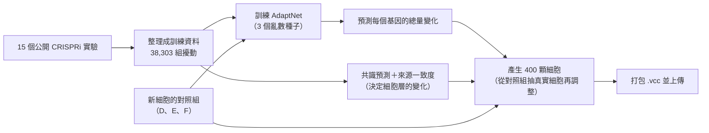

# VCC 2026：預測「關掉一個基因後，細胞會怎麼變」的通用模型

> 這份文件寫給**第一次接觸這個專案的人**，包括沒有生物或機器學習背景的人。
> 先讀「1. 一分鐘看懂」和「2. 背景知識」，就能理解後面所有內容。
> 期末算分的版本是 **v5**（2026/10/24 上傳）。

---

## 目錄

1. [一分鐘看懂](#1-一分鐘看懂)
2. [背景知識：初學者需要知道的生物學](#2-背景知識初學者需要知道的生物學)
3. [比賽規則與評分方式](#3-比賽規則與評分方式)
4. [我們的解法總覽](#4-我們的解法總覽)
5. [訓練資料](#5-訓練資料)
6. [模型：AdaptNet 一步一步看](#6-模型adaptnet-一步一步看)
7. [從預測到 400 顆細胞](#7-從預測到-400-顆細胞)
8. [怎麼驗證（為什麼相信這些數字）](#8-怎麼驗證為什麼相信這些數字)
9. [成績與版本歷史](#9-成績與版本歷史)
10. [主要發現、試過但沒用的方法、限制](#10-主要發現試過但沒用的方法限制)
11. [怎麼執行](#11-怎麼執行)
12. [資料夾與重要檔案導覽](#12-資料夾與重要檔案導覽)
13. [名詞解釋](#13-名詞解釋)
14. [常見問題](#14-常見問題)
15. [時間軸](#15-時間軸)

---

## 1. 一分鐘看懂

**比賽在問什麼？**
主辦單位（美國 Arc Institute）給我們一種新的細胞，但只給「沒被處理過」的樣子（對照組細胞），
再告訴我們要「關掉」哪 300 個基因。我們要預測：每關掉一個基因，這種細胞裡 18,533 個基因的表現會怎麼改變，
而且要用「400 顆細胞的讀數」的形式交出去。

**難在哪裡？**
期末考的三種細胞（代號 D、E、F），我們**完全沒有**它們被關掉任何基因的資料（稱為「零樣本」）。
只能參考其他細胞的實驗結果來推測。

**我們怎麼做？**
1. 收集 15 個公開的基因關閉實驗（9 類細胞、38,303 組「某細胞中關掉某基因」的測量）。
2. 訓練一個小型神經網路 **AdaptNet**：預測「新細胞中關掉基因 X」時，它會學著判斷其他細胞裡關掉 X 的結果，
   哪些比較可信、要怎麼依新細胞的狀態調整。
3. 從新細胞自己的對照組抽出 400 顆真實細胞，依照預測調整讀數，產生要交出去的細胞。
4. 每個改動都先用「模擬考」（答案已知的細胞＋官方評分程式）驗證，有進步才採用。

**成績**：模擬考從原方法的 0.272 進步到 0.306（0 = 最簡單的基準、1 = 實驗重做一次的水準）。

---

## 2. 背景知識：初學者需要知道的生物學

### 基因與基因表現
- 每顆細胞裡有約兩萬個基因。細胞會依需要把基因「抄寫」成 RNA，再做成蛋白質。
- **基因表現**＝某個基因被抄寫成多少 RNA。表現越高，代表這個基因越活躍。
- 同一個人身上的肝細胞、血球、皮膚細胞，基因都一樣，但**哪些基因在表現、表現多少**不一樣，所以長得、功能都不同。

### 單細胞 RNA 定序
- 一種實驗技術，可以一次測上萬顆細胞，數出**每顆細胞裡每個基因有幾個 RNA 分子**（稱為 counts 或 UMI）。
- 結果是一張大表：每一列是一顆細胞、每一欄是一個基因，數字是讀數。
- 比賽的資料就是這種表，每顆細胞有 18,533 個基因的讀數。

### CRISPRi：把一個基因「關小聲」
- CRISPRi 是一種基因工具：用一個不會剪斷 DNA 的 Cas9 蛋白，帶著「抑制器」貼到目標基因上，讓它幾乎不再表現。
- 比賽保證每個目標基因的表現都被壓低 80% 以上。這叫 **knockdown（擊低）**，不是把基因刪除。

### Perturb-seq：一次做幾千個「關基因」實驗
- 把很多細胞分別關掉不同的基因（每顆細胞帶一個「guide」決定關哪個基因），再做單細胞定序。
- 這樣就能知道：關掉基因 A 時，其他所有基因怎麼變；關掉基因 B 時又怎麼變……
- 拿到「不針對任何基因」guide 的細胞叫**對照組**（non-targeting），代表沒被干擾的正常狀態。

### 擾動反應怎麼表示
- 把「關掉 X 的那組細胞」和「對照組細胞」各自平均，再相除取對數，稱為 **log fold change（對數倍數變化）**：
  - 大於 0：這個基因在關掉 X 之後**上升**；小於 0：**下降**；接近 0：沒變。
- 把同一組細胞的讀數加總、當成一顆「平均細胞」來看，叫 **pseudobulk（偽總體）**。

### 必需基因 vs 非必需基因
- **必需基因**：細胞活下去一定要的基因，關掉後細胞會出大問題，反應通常很大、很一致。
- **非必需基因**：關掉後影響較小，而且常常因細胞種類而不同，所以很難預測。
- 期末考的 300 個基因**大多是非必需基因**，這是本專案最大的難點（見第 10 節）。

---

## 3. 比賽規則與評分方式

### 規則重點

| 項目 | 內容 |
| --- | --- |
| 主辦 | Arc Institute，Virtual Cell Challenge 2026 |
| 驗證期 | 細胞 A、B、C，有公開排行榜（到 2026/10/22） |
| 期末考 | 細胞 D、E、F，每種 18,400 顆對照組細胞、300 個要關掉的基因 |
| 要交什麼 | 每個基因 400 顆細胞 × 18,533 個基因的讀數，共 36 萬顆細胞，打包成 `.vcc` 檔 |
| 截止 | 2026/11/05 23:59（UTC），每天最多上傳 2 次，**只算最後一次** |
| 分數公布 | 比賽結束、公布得獎者時才公開（期末期間看不到分數） |

### 六項分數

每一項都換算成：**0 分 = 每個擾動都猜成「平均反應」的簡單基準；1 分 = 同一個實驗重做一次的一致程度**。
總分是六項的平均。分數可以是負的（比基準還差）。

| 項目 | 白話意思 | 主要由誰決定 |
| --- | --- | --- |
| 區分度 `pds_cosine` | 預測能不能分辨「關掉 A」和「關掉 B」的不同 | 每個基因的總量 |
| 整體誤差 `expr_mse` | 每個基因的平均表現量猜得準不準 | 每個基因的總量 |
| 變化大小 `lfc_nmae` | 真正有顯著改變的基因，變化幅度猜得準不準 | 總量與細胞分布 |
| 方向正確 `direction_fidelity` | 我們說「有顯著改變」的基因，升降方向對不對 | 細胞分布 |
| 方向排序 `direction_reach` | 我們最有把握的那些基因，方向是否連續都對 | 細胞分布 |
| 清單重疊 `sig_jaccard` | 我們的「顯著改變基因清單」和真實清單重疊多少 | 細胞分布 |

「顯著改變」是評分程式用統計檢定（Wilcoxon 檢定）比較我們的 400 顆細胞和真實對照組細胞得到的，
所以除了平均值，**每顆細胞的讀數怎麼分布**也會影響分數。這就是第 7 節要分開處理「總量」和「細胞」的原因。

---

## 4. 我們的解法總覽



整個流程分兩大部分：

1. **預測（模型）**：對每個「新細胞 × 被關掉的基因」，預測 18,533 個基因的變化量。
2. **產生細胞（渲染）**：把預測變成 400 顆細胞的讀數，同時顧好評分程式看的「平均」和「分布」。

---

## 5. 訓練資料

### 15 個公開實驗

| 細胞 | 細胞是什麼 | 資料來源 | 擾動數 | 授權 |
| --- | --- | --- | --- | --- |
| K562 | 慢性骨髓性白血病細胞 | Replogle et al. 2022，全基因組 | 1,649 | CC BY 4.0 |
| K562ess | 同上 | Replogle et al. 2022，必需基因 | 2,021 | CC BY 4.0 |
| VIPK562 | 同上 | VIPerturb-seq（Satija lab，2026，10x Flex） | 6,168 | CC BY 4.0 |
| HCT116 | 大腸癌細胞 | X-Atlas/Orion（Xaira） | 1,690 | CC BY-NC-SA 4.0 |
| HEK293T | 胚胎腎細胞 | X-Atlas/Orion（Xaira） | 1,697 | CC BY-NC-SA 4.0 |
| H1 | 胚胎幹細胞 | Virtual Cell Challenge 2025 | 300 | CC0 |
| CD4_Rest / Stim8hr / Stim48hr | 人類 CD4 T 細胞（休息、刺激 8 小時、48 小時） | Marson lab 全基因組 CRISPRi | 670 / 677 / 675 | MIT |
| HepG2 | 肝癌細胞 | Nadig et al. 2025，必需基因 | 2,160 | 未註明 |
| Jurkat | T 細胞白血病 | Nadig et al. 2025，必需基因 | 2,270 | 未註明 |
| FengNF / FengF | 誘導多能幹細胞（34 位捐贈者） | Feng et al. 2025（非必需／必需基因組） | 2,873 / 1,885 | MIT |
| KOLF | 誘導多能幹細胞 | KOLF2.1J 全基因組 CRISPRi（Nature Biotechnology 2026） | 11,364 | CC BY 4.0 |
| RPE1 | 視網膜色素上皮細胞 | Replogle et al. 2022，必需基因 | 2,204 | CC BY 4.0 |
| **合計** | **9 類細胞** | | **38,303** | |

另外用了兩個**基因知識庫**：STRING（蛋白質之間的交互作用網路）和 Gene Ontology（基因功能註解），
用來推測「從沒被任何實驗關掉過的基因」。

### 資料怎麼整理（`scDFM/repro/model_v2_20261022/build_data.py`）

對每個實驗、每個被關掉的基因：

1. 把「關掉這個基因的所有細胞」的讀數加總，對照組也加總（pseudobulk）。
2. 換算成每 5 萬個讀數的比例，計算和對照組的對數比值（log ratio），太低表現的基因標成缺值。
3. 減掉這個實驗所有擾動的平均反應（每個實驗都有自己的「共同反應」，會干擾跨細胞比較）。
4. 估計每個數字的雜訊大小（由細胞數和讀數算出）。

結果存成 `data/stage3/model_v2/<細胞>.npz`，每個檔案是一張「擾動 × 18,533 個基因」的表。

---

## 6. 模型：AdaptNet 一步一步看

程式在 `scDFM/repro/model_v2_20261022/adaptnet.py`。

### 核心想法

要預測「在新細胞 c 裡關掉基因 X」，最好的線索是「**其他細胞裡關掉 X 的實驗結果**」（稱為「來源」）。
但來源的可信度差很多：有的細胞跟 c 很像、有的不像；有的實驗細胞數很多、有的很少；有的來源互相矛盾。
AdaptNet 就是學「怎麼組合這些來源」的小型神經網路。

### 三個步驟

| 步驟 | 做什麼 | 比喻 |
| --- | --- | --- |
| ① 來源加權 | 看每個來源的特徵（細胞數、擊低程度、和新細胞的相似度、和其他來源是否一致、反應大小），給每個來源一個權重 | 問很多位醫生的意見，越可靠的人意見越重 |
| ② 拆成基因程式 | 把反應拆成 200 組「常常一起變動的基因」（從所有訓練資料找出來），再加上細節 | 把一首歌拆成主旋律和裝飾音 |
| ③ 依新細胞調整 | 根據新細胞對照組的狀態（用 8 個數字摘要），調整每組程式要放大還是縮小 | 同一首歌，在不同場地調整音量 |

輸出是新細胞中 18,533 個基因的預測變化量。

### 怎麼訓練

- 每一步隨機選一種訓練細胞當作「假裝的新細胞」，把它從來源中藏起來，只用其他細胞預測它，再跟真實答案比較。
  這樣模型一直在練習「預測沒看過的細胞」，跟期末考的情況一樣。
- 損失函數有兩部分：(1) 預測誤差（相對於簡單平均法）；(2) 對比學習：每個擾動的預測要最像自己的真實答案、不像別的擾動。
- 約 **2 萬個參數**，訓練 1,500 步，在 RTX 4060 Ti 上約 1 分鐘。期末版本是 **3 個不同亂數種子的模型取平均**，讓結果更穩定。

### 為什麼故意做得這麼小？

- 我們試過大模型：一開始重現並測試了現成的生成模型 **scDFM**（ICLR 2026），在新細胞上學不到擾動訊號（接近亂猜）；
  也試過讓每個基因有自己可學參數的網路，結果會把 15 種細胞「背起來」，換到新細胞反而更差。
- 訓練資料只有 9 類細胞，模型太大就會過度擬合。小模型只學「怎麼組合來源」這種能推廣的規則。

### 被關掉的基因本身與附近的基因

- 被關掉的基因本身固定預測下降約 85%（比賽保證 > 80%）。
- CRISPRi 也會影響基因組上**很近的鄰居基因**（50 kb 內），這部分由共識模型（`scDFM/vcc/gm.py`）從所有實驗統計出來。

### GeneNet4：從沒被測過的基因

程式在 `genenet.py`。如果某個基因從沒被任何實驗關掉過，就沒有來源可以參考。
GeneNet4 改用 STRING 和 Gene Ontology 找出**功能最像的 32 個基因**，用它們被關掉時的反應來推測，並學會該相信多少。
期末考的 300 個基因都有測量資料，所以期末沒有用到這條路，但它讓模型可以處理「任何基因」。

---

## 7. 從預測到 400 顆細胞

程式在 `tools/final_pipeline.sh`（總指揮）、`tools/make_bulk_effects.py`（總量）、
`tools/cell_effects.py`（細胞層變化）、`vccsub/make_effect_submission.py` 與 `scDFM/vcc/render.py`（產生細胞）。

### 第一步：每個基因的總量（決定區分度與整體誤差）

總量 ＝ 被關掉的基因本身 ＋ 鄰居基因 ＋ 倍率 × AdaptNet 的預測，再經過三個處理：

1. **移除 5 個對照組雜訊方向**：新細胞的對照組細胞之間本來就有差異（例如細胞週期），
   預測中沿著最主要的 5 個差異方向的成分，在資料雜訊大時會干擾區分度，所以拿掉。
2. **依可信度調整每個擾動的大小**：來源之間越一致、來源越多的擾動，預測得越大；反之縮小（目標權重，0.5 次方）。
3. **整體倍率依評分規則校準**：評分程式會扣「預測變化太誇張」的分數，所以整體大小設在評分規則的最佳點（budget = claim）。

### 第二步：產生細胞（決定「顯著基因」相關的四項分數）

1. 從新細胞自己的對照組**隨機抽 400 顆真實細胞**當底，保留真實的細胞差異和雜訊。
2. 套上細胞層的變化（共識預測 × 來源一致度 × 4.5 倍）：下降的基因隨機減少讀數、上升的基因隨機增加讀數。
3. 最後讓每個基因在 400 顆細胞的**總量剛好等於第一步的總量**，多出或不足的讀數放在讀數最高的 2% 細胞。

為什麼要分開？評分程式的區分度和整體誤差只看平均，但「顯著基因」是用每顆細胞的分布做統計檢定。
兩者的最佳做法不同，所以總量和細胞層的變化分開控制。

---

## 8. 怎麼驗證（為什麼相信這些數字）

期末考看不到分數，所以**所有改動都要先自己驗證**。我們用三種方法：

| 方法 | 做法 | 回答的問題 |
| --- | --- | --- |
| 藏起整種細胞（7 折交叉驗證） | 7 組細胞輪流藏起來，用其他資料訓練後預測它 | 對沒看過的細胞準不準？ |
| 藏起一批基因 | 一批基因完全不給模型看，再預測它們 | 對沒測過的基因準不準？ |
| 模擬考（官方評分程式） | 把答案已知的細胞當成期末考，跑完整流程，用官方程式 cell-eval2 打分 | 改動對真正的分數有沒有幫助？ |

模擬考有三套：

| 模擬考 | 細胞 | 組數 | 每顆細胞讀數 | 說明 |
| --- | --- | --- | --- | --- |
| H1 | 胚胎幹細胞 | 5 組 × 約 60 個基因 | 約 24,000 | 讀數深度最接近期末考（約 20,000），最可靠 |
| HCT116 | 大腸癌細胞 | 4 組 × 約 66 個基因 | 約 12,000 | 資料較淺，換算分數不穩定，看原始分數 |
| KOLF200 | 誘導多能幹細胞 | 4 組 × 約 70 個基因 | 約 3,900 | 同上 |

**採用規則**：一個改動要在模擬考大多數組別都進步、其他細胞也沒有明顯退步，才會放進期末版本。

另外做了兩個「快速試算」工具，不用產生細胞就能估分數，幾秒鐘就能比較很多設定：

- `mse_proxy.py`：從總量直接算整體誤差和區分度（區分度和官方值完全一致）。
- `de_sim.py`：假設我們挑了哪些基因當顯著、方向如何，直接用官方程式的函數算四項 DE 分數。

---

## 9. 成績與版本歷史

### 期末提交（D、E、F）

| 版本 | 上傳時間（台灣） | 內容 | H1 模擬考總分 |
| --- | --- | --- | --- |
| v1 | 10/22 19:44 | 共識模型（各來源平均）＋細胞產生流程（保底） | 0.272 |
| v2 | 10/23 01:30 | 總量改用訓練的 AdaptNet | 0.291 |
| v4 | 10/23 18:40 | ＋RPE1 資料、不移除對照組方向、目標權重、3 個模型平均 | 0.306 |
| **v5** | **10/24 00:24** | **v4 改成只移除 5 個對照組方向（目前算分的版本）** | **0.306** |

v5 在 H1 和 v4 持平，但在 HCT116、KOLF 模擬考的區分度明顯較高（原始分數 0.70 → 0.75、0.60 → 0.65），所以比較穩健。
（v3 只做好沒有上傳。）

### v5 在 H1 模擬考的六項分數

| 區分度 | 整體誤差 | 變化大小 | 方向正確 | 方向排序 | 清單重疊 | **總分** |
| --- | --- | --- | --- | --- | --- | --- |
| 0.87 | 0.17 | −0.02 | 0.55 | 0.08 | 0.20 | **0.306** |

### 藏起整種細胞的測試（7 折平均）

| 方法 | 方向相似度（1 = 完全一致） | 區分度（0.5 = 亂猜） |
| --- | --- | --- |
| 各來源直接平均（原方法） | 0.111 | 0.738 |
| AdaptNet | 0.131 | 0.762 |
| AdaptNet＋RPE1 資料 | **0.152** | **0.766** |

### 驗證期公開排行榜（A、B、C）

我們用舊流程最佳 0.239，在 1,635 隊中排第 165 名（第 2–40 名約 0.30–0.35）。
新模型是驗證期結束後才完成的，所以排行榜上沒有新模型的成績。

---

## 10. 主要發現、試過但沒用的方法、限制

### 最重要的發現：瓶頸在「方向」

- 模型最有把握的那些基因，升降方向猜對的比例：**必需基因 70–80%，非必需基因只有 53–58%**（接近丟銅板）。
- 期末考的基因大多是非必需基因，所以「顯著基因、方向」相關的四項分數很難提升。
- 我們用模擬實驗證明：如果方向全對，這幾項會大幅提升，所以問題不在產生細胞的方式，而在資料能提供的資訊。
- 相對地，**區分度已達實驗重複水準的約 87%**。

### 試過但沒採用（詳細數字在 `scDFM/repro/model_v2_20261022/SUMMARY.md`）

| 嘗試 | 結果 |
| --- | --- |
| 加入新細胞的「共同反應」 | 若事先知道答案可 +0.03，但用其他細胞無法預測（相關係數約 0.1–0.3） |
| 用細胞週期比例解釋反應 | 只能解釋約 4% |
| 專門學「方向」的訓練目標 | 和原本相同（模型只是在重新分配來源權重） |
| 用對照組細胞的自然差異推測 | 等於亂猜（目標基因表現太低、資料太稀疏） |
| 更真實的下降基因產生方式 | 三種細胞結果不一致 |
| 訓練時加重高表現量基因 | 在誤差範圍內 |
| 預測每個擾動會影響幾個基因 | 反而變差 |
| 依目標基因在新細胞的表現量縮放 | 幾乎沒有關係（相關係數 0.06） |
| 更多資料：ELEM-1200RS、LINCS、神經細胞、A549 | 沒幫助、變差，或和期末考基因重疊太少 |

### 限制

- 期末考細胞和訓練資料差很多：從標記基因看，D 像骨髓性白血病細胞、E 像纖維母細胞、F 像上皮／間質癌細胞。
- 能涵蓋這 300 個基因的大型公開實驗都已經加入，再往上需要和期末考細胞相似的新資料。

---

## 11. 怎麼執行

> 程式裡的路徑寫死在原本的工作機 `/home/zxc29051617/VCC`。換機器時，用編輯器把這個路徑全部取代成新位置。

### 需要的環境

| 項目 | 原本的設定 |
| --- | --- |
| 作業系統 | Linux |
| 顯示卡 | NVIDIA GPU，8 GB 以上（原本是 RTX 4060 Ti 16 GB） |
| 記憶體 | 15 GB 以上（重的工作一次只跑一個，避免記憶體不足） |
| 硬碟 | 資料約 40 GB；打包一個 `.vcc` 尖峰需要約 37 GB 暫存空間 |
| 模型環境 | Python 3.11，套件見 `requirements.txt`（`scDFM/.venv`） |
| 評分環境 | 另一個 Python 3.11 環境，安裝 `cell-eval2==0.18.0`、`pdex==0.3.0`（`evalenv`） |
| 上傳工具 | `vcc-cli 0.3.0`（`uv tool install vcc-cli`），需要主辦單位的帳號金鑰 |

### 需要的資料（不在 repo 裡）

| 位置 | 內容 | 怎麼產生 |
| --- | --- | --- |
| `data/vcc2026/`、`data/vcc2026_final/` | 主辦單位給的 A/B/C、D/E/F 對照組 | `vcc datasets download controls` |
| `data/stage3/stats`、`stats_ext` | 各實驗的 pseudobulk 彙總 | `scDFM/vcc/stats.py`、`stats_ext.py`，`tools/` 裡的下載與轉換程式 |
| `data/stage3/model_v2/*.npz` | 訓練資料（第 5 節） | `build_data.py`、`rpe1_build.py` |
| `scDFM/repro/signature_20261013/cache/` | 各來源的一致度 | `cache_contexts.py` |
| `data/mock_h1`、`data/mock_hct116`、`data/mock_kolf200` | 模擬考資料 | `mock_data.py`、`mock_data_loco.py` |

### 重建期末版本 v5

```bash
cd scDFM
# 1. 訓練 3 個 AdaptNet（亂數種子 0、1、2），預測 D、E、F 每個基因的總量輸入，寫出 gm_final_v4pre*
RPE1=1 SEEDS=0,1,2 .venv/bin/python -I repro/model_v2_20261022/build_v2.py v4
cd ..
# 2. 產生 36 萬顆細胞並打包（約 20 分鐘）
PRECOMP=/home/zxc29051617/VCC/data/stage3/effects/gm_final_v4pre RENDER=g1 SHAREDK=0 GAMMA=1 CTRLAXES=5 \
  TWPOW=0.5 CELLAGREE=1 CELLAMP=1.5 TOPFRAC=0.02 bash tools/final_pipeline.sh data/vcc2026_final gm_final_v5 D E F
# 3. 上傳（只算最後一次上傳，務必先和隊友確認）
~/.local/bin/vcc submit vccsub/out/gm_final_v5.vcc -m gm_final_v5 --wait
```

`final_pipeline.sh` 的設定（環境變數）：

| 設定 | v5 的值 | 意思 |
| --- | --- | --- |
| `PRECOMP` | `gm_final_v4pre` | 使用 AdaptNet 預先算好的總量輸入 |
| `RENDER=g1` | | 總量與細胞分開控制的產生方式 |
| `SHAREDK=0` | | 不移除各擾動共有的成分 |
| `GAMMA=1` | | 不額外放大強的擾動 |
| `CTRLAXES=5` | | 移除 5 個對照組雜訊方向 |
| `TWPOW=0.5` | | 依來源一致度與來源數調整每個擾動的大小 |
| `CELLAGREE=1`、`CELLAMP=1.5` | | 細胞層變化 = 共識預測 × 來源一致度 × 4.5 倍 |
| `TOPFRAC=0.02` | | 總量的調整放在讀數最高的 2% 細胞 |

### 跑模擬考

```bash
cd scDFM
# H1 模擬考（5 組）；名稱自取，最後的字串是要測的設定
RPE1=1 SEEDS=0,1,2 .venv/bin/python -I repro/model_v2_20261022/mock_exam.py 0,1,2,3,4 我的測試 "CELLAGREE=1;CELLS_FROM_A=1;CTRLAXES=5;TWPOW=0.5"
# HCT116、KOLF200 模擬考（各 4 組）
MOCK_SET=hct116 RPE1=1 SEEDS=0,1,2 .venv/bin/python -I repro/model_v2_20261022/mock_exam.py 0,1,2,3 我的測試 "CELLAGREE=1;CELLS_FROM_A=1;CTRLAXES=5;TWPOW=0.5"
# 看結果
.venv/bin/python -I repro/model_v2_20261022/mock_cmp.py 0,1,2,3,4 v4_ax5 我的測試            # H1 換算分數（v4_ax5 = 期末 v5）
.venv/bin/python -I repro/model_v2_20261022/mock_raw.py 0,1,2,3 hct116_v4_ax5 hct116_我的測試  # HCT116 原始分數
```

每組約 3–5 分鐘；評分程式約用 7 GB 記憶體，不要同時跑兩個。

### 跑基準測試

```bash
cd scDFM
RPE1=1 .venv/bin/python -I repro/model_v2_20261022/bench.py consensus_d200     # 藏起細胞的基準
RPE1=1 .venv/bin/python -I repro/model_v2_20261022/run_genenet4_bench.py genenet4_test   # GeneNet4（參數是結果名稱）
RPE1=1 .venv/bin/python -I repro/model_v2_20261022/bench_genes.py blend          # 藏起基因（不給參數會跑全部方法，很久）
RPE1=1 .venv/bin/python -I repro/model_v2_20261022/bench_sign.py adaptnet        # 方向猜對率
```

---

## 12. 資料夾與重要檔案導覽

```
general_model/
├── README.md                     ← 這份文件
├── requirements.txt              ← 模型環境的套件版本
├── docs/
│   ├── VCC_progress_report_20261024.pptx   ← 給教授的進度簡報（每頁有講稿備註）
│   └── STAGE3_PLAN.md
├── tools/                        ← 期末流程與資料處理
│   ├── final_pipeline.sh         ← 總指揮：預測 → 總量 → 細胞 → 打包 → 檢查
│   ├── make_bulk_effects.py      ← 每個基因的總量（對照組方向、目標權重、評分規則校準）
│   ├── cell_effects.py           ← 細胞層的變化（共識 × 來源一致度）
│   ├── target_weights.py         ← 每個擾動的可信度權重
│   └── ...                       ← 各資料集的下載、轉換程式
├── vccsub/
│   ├── make_effect_submission.py ← 把預測變成 400 顆細胞
│   ├── pack_vcc.py               ← 打包成官方 .vcc 格式
│   └── writer.py                 ← 省記憶體地寫出大檔案
└── scDFM/
    ├── vcc/                      ← 共識模型與共用工具
    │   ├── gm.py                 ← 共識模型（鄰居基因效應、各來源平均）
    │   ├── render.py             ← 產生細胞的核心演算法
    │   ├── contexts.py、stats.py ← 讀取與彙總各實驗資料
    │   └── ...
    └── repro/
        ├── model_v2_20261022/    ← 期末模型（最重要）
        │   ├── SUMMARY.md        ← 所有實驗的完整紀錄與數字
        │   ├── adaptnet.py       ← AdaptNet 模型
        │   ├── genenet.py        ← GeneNet4（沒測過的基因）
        │   ├── responsenet.py    ← 資料載入、細胞狀態摘要
        │   ├── bench*.py         ← 各種基準測試
        │   ├── build_data.py     ← 建立訓練資料
        │   ├── build_v2.py       ← 為 D/E/F 訓練並預測
        │   ├── mock_exam.py      ← 模擬考
        │   ├── mse_proxy.py、de_sim.py ← 快速試算
        │   ├── results/、mock/   ← 基準測試與模擬考的結果
        │   └── deck/             ← 簡報的原始檔與產生程式
        ├── next_20261019/        ← A/B/C 時期的流程實驗（run.log 是逐日紀錄）
        ├── signature_20261013/   ← 來源加權實驗、一致度快取的產生程式
        └── *.md                  ← 早期的計畫、資料調查、方法紀錄
```

---

## 13. 名詞解釋

| 名詞 | 意思 |
| --- | --- |
| 擾動（perturbation） | 對細胞做的處理，這裡指用 CRISPRi 關掉一個基因 |
| 目標基因（target） | 被關掉的那個基因 |
| 對照組（control / non-targeting） | 沒有被關掉任何基因的細胞 |
| 情境 / context | 一種細胞（加上實驗條件），例如 K562、H1、D |
| knockdown（擊低） | 基因表現被壓低，不是刪除 |
| counts / UMI | 單細胞定序數到的 RNA 分子數 |
| pseudobulk | 把一組細胞的讀數加總，當作一顆平均細胞 |
| log fold change | 和對照組相比的對數倍數變化，正 = 上升、負 = 下降 |
| 共同反應（common mode） | 同一個實驗裡大部分擾動都會出現的變化 |
| 來源（source） | 同一個目標基因在其他細胞的測量結果 |
| 共識模型（consensus） | 把各來源平均的簡單方法（原方法） |
| 基因程式（program） | 常常一起上升或下降的一群基因 |
| 零樣本（zero-shot） | 期末考細胞沒有任何擾動資料可以學 |
| 交叉驗證 | 輪流藏起一部分資料當考題，用其他資料訓練 |
| 亂數種子（seed） | 控制隨機性的數字；不同種子訓練出的模型略有不同，取平均更穩 |
| 顯著（significant） | 統計檢定認為「真的有變」，不是雜訊 |
| budget = claim | 評分規則中，預測整體變化大小的最佳點 |

---

## 14. 常見問題

**Q：為什麼不用大型的「虛擬細胞」基礎模型？**
A：我們試過現成的生成模型 scDFM，在新細胞上學不到擾動訊號；大模型在只有 9 類細胞的資料上會過度擬合。
小模型專注學「怎麼組合其他細胞的實驗結果」，在藏起細胞的測試中最準。

**Q：模擬考的分數就是期末的分數嗎？**
A：不是。模擬考用的是 H1 等其他細胞，只用來比較「哪個版本比較好」。期末考細胞更不像訓練資料，實際分數可能較低。

**Q：為什麼區分度高，方向類分數卻很低？**
A：區分度只要求「不同擾動的預測彼此不同、而且大致像各自的答案」；方向類分數要求每個基因升降都猜對。
非必需基因的反應在不同細胞間常常方向不同，所以後者難很多。

**Q：可以再加什麼資料讓它更好？**
A：最有幫助的是和期末考細胞相似（骨髓性白血病、纖維母細胞、上皮癌細胞），而且涵蓋這 300 個基因的擾動資料。
目前找到的公開資料重疊都太少。

**Q：執行時記憶體不夠怎麼辦？**
A：重的工作（評分程式、打包、訓練）一次只跑一個；打包前確認硬碟至少有 40 GB 空間。

---

## 15. 時間軸

| 日期 | 事件 |
| --- | --- |
| 10/09 | 重新開始（舊流程保留在 repo 根目錄），規劃四個階段 |
| 10/10 | 第一次上傳（各來源平均 × 1.5）：0.127；加入 CD4 T 細胞：0.149 |
| 10/11 | 共識模型（鄰居基因效應＋各來源平均）上線 |
| 10/19 | 每個基因總量精確對齊：0.161；移除共有成分：0.181 |
| 10/20 | 依評分規則縮小總量：0.203；細胞層放大 4.5 倍＋讀數放在前 2% 細胞 |
| 10/21 | 改良總量（深度加權、一致度、目標權重）：0.239（驗證期最佳，第 165 名） |
| 10/22 | 期末開始（D、E、F）；上傳 v1 保底；開始訓練 AdaptNet |
| 10/23 | H1 模擬考確認 AdaptNet 較好，上傳 v2；GeneNet4、RPE1 資料；診斷 DE 分數瓶頸；上傳 v4 |
| 10/24 | 三套模擬考確認「只移除 5 個對照組方向」較穩健，上傳 v5；給教授的進度簡報 |
